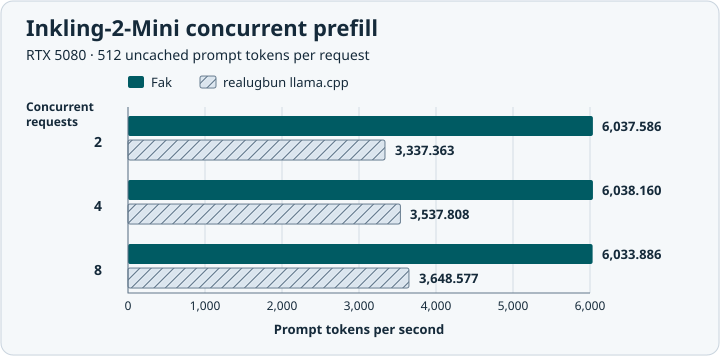

<p align="center">
  <picture><source media="(prefers-color-scheme: dark)" srcset="visuals/brand/fak-logo.svg"></picture>
</p>

# fak

fak is a local coding runtime.
Run a model on your own computer and keep your prompts local. Connect your
coding agent through fak’s gateway to allow reads while blocking writes.

[](docs/benchmarks/README.md)

On one RTX 5080, fak’s own engine decodes Inkling-2-Mini at 119.9 tok/s,
level with the fastest llama.cpp fork at 119.5. That is parity, not a lead:
fak’s number comes from its in-process bench and the fork’s from `llama-bench`.
Prefill is where fak pulls ahead: with 4-bit expert weights and activations
(NVFP4 W4A4, the default on an `sm_120f` build from `main`), it reads a
512-token prompt at 5861 tok/s against 3012 for the fork, 1.95x. That is the
server’s prompt rate; fak’s first visible token still arrives later than the
fork’s. At 1,946 tokens of context fak still trails the fork on decode, 89.0 vs
113.8 tok/s. The [benchmark index](docs/benchmarks/README.md) links the
receipts and the other comparisons.

A matched HTTP test on one RTX 5080 measured aggregate prefill for uncached
512-token prompts with one output token per request. Fak revision `e7ad0c8dee5`,
run with the fixed benchmark profile, led the realugbun llama.cpp fork, the
faster of the two OSS builds tested, in both halves of the ABBA run.



| Concurrent requests | Fak prompt tok/s | Fork prompt tok/s | Smaller half-run speedup |
| ---: | ---: | ---: | ---: |
| 2 | 6,037.586 | 3,337.363 | 1.802× |
| 4 | 6,038.160 | 3,537.808 | 1.675× |
| 8 | 6,033.886 | 3,648.577 | 1.633× |

The rates are pooled medians. The one-token fixture yielded no visible first
token, so this run measured prompt throughput and left visible latency unmeasured.

## Try fak

[Install fak for your platform](INSTALL.md#local-model-setup), then open a
terminal.

On Apple Silicon, `fak up` probes unified memory, picks a model tier, and
opens a chat prompt:

```sh
fak up
```

On Windows x64 and Linux x64, `fak up` is not available (it is the Apple
Silicon provisioner). Run the small SmolLM2 model in-kernel instead. The first
run downloads it:

```sh
fak run smollm2 "What input breaks def first(xs): return xs[0]? Write a test that catches it."
```

Look for a test that passes an empty list and checks for `IndexError`.

On an M3 or later Mac with 24 GB of memory or more and macOS 26.4 or later,
fak v0.59.0 can also run Inkling-2-Mini on the GPU by name:

```sh
go install github.com/anthony-chaudhary/fak/cmd/fak@v0.59.0
fak run inkling2-mini
```

Or build from a clone of `main`: `git clone --depth 1
https://github.com/anthony-chaudhary/fak.git`, then `go build -o fak ./cmd/fak`
(needs Go 1.26+).

The first run downloads about 14.6 GB. On an Apple Silicon Mac with 24 GB or
more, `fak run` with no model picks Inkling-2-Mini as well. The release
installer downloads the prebuilt Metal archive on Apple Silicon. Smaller Macs and other
platforms get smaller model tiers instead. The [Mac guide](docs/fak/mac-local-models.md#inkling-2-mini-the-first-run-default)
has the requirements and the server commands.

Inkling-2-Mini uses concurrent prefill by default when the CUDA backend supports
native NVFP4 W4A4 and f16 sequence and cohort operations. The admission policy
uses a 25 ms batch gap and a 75 ms batch wait across eligible devices. f16 uses
half the KV bytes of fp32. The server sizes context and checks fit against
available device memory, so capacity and throughput vary by device and workload.
The collection window can add latency to an isolated request.
Use the path to your GGUF file.

```sh
fak serve --engine inkernel --backend cuda \
  --gguf /path/to/Inkling-2-Mini-UD-Q3_K_XL.gguf \
  --addr 127.0.0.1:8080
```

Set `FAK_INKLING2_SERVE_BATCH=0` to disable batching. To reproduce the fixed
640-token benchmark context and its settings, use the
[benchmark environment example](examples/inkling2-cuda-prefill.env.example).

For the commands and their main flags, see the [CLI reference](docs/CLI.md).

For build requirements, platform verification and other model sizes, see the
[local model setup guide](GETTING-STARTED.md#local-model-setup).

For the version history, see [CHANGELOG.md](CHANGELOG.md).

[Connect your coding agent](docs/integrations/README.md) · [Hardware benchmarks](docs/benchmarks/README.md) · [How fak compares with llama.cpp](docs/native-inference-goal.md) · [Documentation](docs/index.md)

[Apache-2.0 license](LICENSE)

<!-- readme-verified: 2026-11-26 vs VERSION 0.59.0 + BENCHMARK-AUTHORITY · appeal-verified: 2026-11-25 · process: tools/readme_freshness_audit.py + tools/doc_appeal_scorecard.py + /refresh-readme -->
