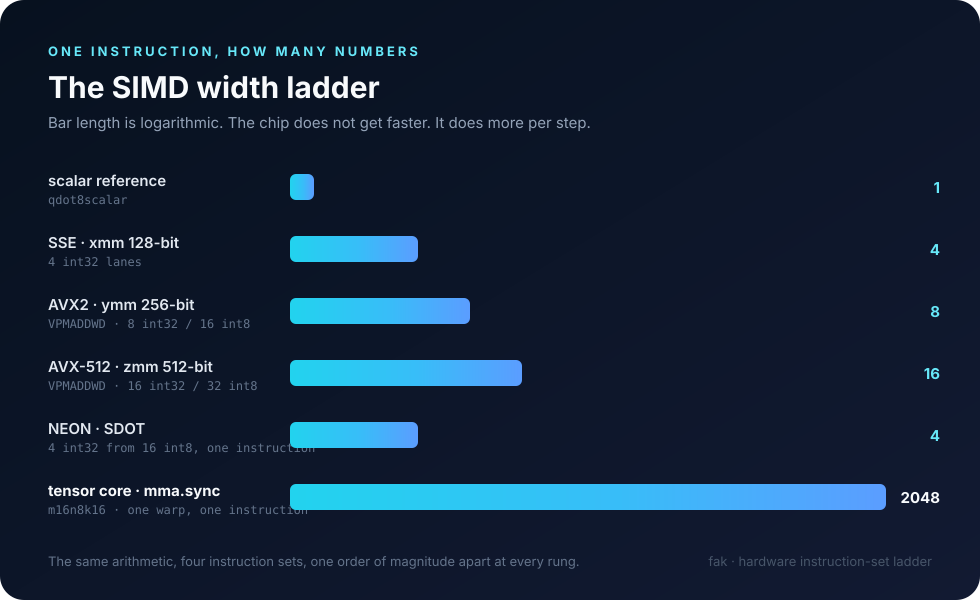

# One instruction, many numbers

> **In one breath:** A normal instruction handles one number at a time. A wide instruction
> handles many at once. The chip does not get faster, it just does more per step. That
> single trick is most of the speed in modern inference.

**One line:** single instruction, multiple data — SIMD — is the technique of packing many
numbers into one wide register so that one instruction performs the same operation on all
of them simultaneously, and it is the reason a quantized model can run at all.

*You are on **Level 2 of 5** of the [fak hardware instruction-set ladder](README.md).*

> **Audience.** You know what a loop is. You have heard the word SIMD and you are not
> sure what it buys. You are comfortable reading a short code snippet. You do not need to
> have written assembly before; every instruction below is explained.
>
> **Short answer.** A processor's arithmetic unit is wide. It can add two 512-bit numbers
> in about the same time it takes to add two 32-bit numbers. SIMD is the trick of putting
> sixteen or sixty-four small numbers into that wide register so one instruction does
> sixteen or sixty-four multiplies. fak's quantized kernels are built entirely on this,
> and they are held bit-identical to a plain scalar loop so the speed costs nothing in
> correctness.

## The question that starts this rung

Here is the inner loop of a quantized matrix multiply. It is the single hottest loop in
all of inference. From [`internal/model/quant.go:213`](../../../internal/model/quant.go):

```go
func qdot8scalar(qw []int8, dw []float32, qv q8Vec, nblk int) float32 {
	var acc float32
	qx := qv.q
	dx := qv.d
	for b := 0; b < nblk; b++ {
		wb := qw[b*qBlk:]
		xb := qx[b*qBlk:]
		var s0, s1, s2, s3 int32
		for i := 0; i < qBlk; i += 4 {
			s0 += int32(wb[i]) * int32(xb[i])
			s1 += int32(wb[i+1]) * int32(xb[i+1])
			s2 += int32(wb[i+2]) * int32(xb[i+2])
			s3 += int32(wb[i+3]) * int32(xb[i+3])
		}
		acc += float32((s0+s1)+(s2+s3)) * dw[b] * dx[b]
	}
	return acc
}
```

**Checkpoint:** before reading on, answer this. This loop multiplies and adds 32 pairs of
numbers per block. How many separate multiply instructions does the processor execute for
one block?

The answer is 32. One multiply per pair. The processor has no idea that these 32
multiplies are related, that they are all part of one dot product, or that they could be
done together. It just grinds through them one at a time.

That is the problem this rung solves.

## What is a dot product, and why does inference care?

A **dot product** takes two lists of numbers of the same length, multiplies them
element-by-element, and adds up all the products.

```
weights:    [ 2,  3,  1,  4]
inputs:     [ 5,  1,  2,  1]
products:   [10,  3,  2,  4]
dot product: 10 + 3 + 2 + 4 = 19
```

That is it. Four multiplies and three adds.

Now here is the thing that makes this the most important operation in the world of
inference: **a neural network's forward pass is almost nothing but dot products.** Every
linear layer is a matrix times a vector, which is a stack of dot products. Every attention
score is a dot product. When you ask a language model a question, the arithmetic it
performs is overwhelmingly "multiply these two lists element by element and add up the
results," repeated an astronomical number of times.

So if you can make the dot product faster, you make everything faster. And the dot product
has a property that makes it perfect for a trick: **the 32 multiplies are independent.**
None of them needs the result of any other. They can all happen at the same time.

**Checkpoint:** why does it matter that the multiplies in a dot product are independent of
each other?

## The trick: make the register wide

A processor's arithmetic unit is not one adder wide. It is much wider than the numbers you
usually put in it.

Think of it this way. A 32-bit adder and a 512-bit adder are both "one adder" from the
chip's point of view. They take about the same time to produce a result. But the 512-bit
one can hold sixteen 32-bit numbers, or sixty-four 8-bit numbers, side by side.

So: instead of putting one number in the adder and getting one result, put sixteen numbers
in and get sixteen results. Same instruction. Same time. Sixteen times the work.

That is SIMD. **Single instruction, multiple data.** One instruction, many numbers.



The registers have names, and the names encode the width:

| Register | Width | Holds |
|---|---|---|
| `xmm` | 128 bits | 16 int8, or 4 int32, or 4 float32 |
| `ymm` | 256 bits | 32 int8, or 8 int32, or 8 float32 |
| `zmm` | 512 bits | 64 int8, or 16 int32, or 16 float32 |

On ARM the registers are called `V0` through `V31` and are 128 bits wide, holding 16 int8
or 4 int32.

**Checkpoint:** a `zmm` register is 512 bits. How many 8-bit integers fit in it? How many
32-bit integers?

## The catch: the numbers have to be the right shape

Here is where it gets interesting, and where the real engineering lives.

The dot product multiplies int8 by int8. But the *accumulator* — the running sum — has to
be wider, because adding up 32 products of numbers up to 127 each gives a result up to
about 520,000, which does not fit in 8 bits. It does not even fit in 16 bits.

So the hardware has to widen as it goes. And the widening is not free. It is a separate
instruction.

This is the actual shape of the problem, and it is why the kernels look the way they do:

```
int8 × int8  →  int16  →  pairwise add  →  int32  →  accumulate
   (input)      (widen)     (VPMADDWD)     (sum)
```

Let us watch fak do exactly this.

## The AVX2 kernel, line by line

From [`internal/model/quant_amd64.s:29`](../../../internal/model/quant_amd64.s):

```asm
VPMOVSXBW (SI), Y0        // 16 int8 from memory -> 16 int16 in Y0
VPMOVSXBW (DI), Y1        // 16 int8 from memory -> 16 int16 in Y1
VPMADDWD  Y1, Y0, Y0      // pairwise multiply-add -> 8 int32 in Y0
```

Three instructions. Let us decode each one.

**`VPMOVSXBW (SI), Y0`** — "vector packed move with sign extension, byte to word." It reads
16 bytes from the address in `SI`, sign-extends each one from 8 bits to 16 bits, and puts
the 16 results in `Y0`. This is the widening step. It is one instruction for all 16 values.

**`VPMADDWD Y1, Y0, Y0`** — "vector packed multiply and add words." This is the clever one.
It takes the 16 int16 values in `Y0` and the 16 in `Y1`, multiplies them pairwise, and then
**adds adjacent pairs** of the 32-bit products. So 16 multiplies plus 8 adds, in one
instruction, producing 8 int32 values.

That is 16 multiply-accumulates in a single instruction. Compare to the scalar loop's one.

**Checkpoint:** `VPMADDWD` produces 8 int32 values from 16 int16 inputs. Where did the
other 8 go? Answer: they were added together in pairs. That is the "and add" in the name.

A Q8_0 block is 32 values, not 16, so the kernel does this twice and adds the halves
([`quant_amd64.s:32`](../../../internal/model/quant_amd64.s)):

```asm
VPMOVSXBW 16(SI), Y2
VPMOVSXBW 16(DI), Y3
VPMADDWD  Y3, Y2, Y2
VPADDD    Y2, Y0, Y0      // 8 int32 partials from the whole 32-wide block
```

Now `Y0` holds 8 int32 partial sums. But we need *one* number: the total. So the kernel has
to add those 8 lanes together. That is the **horizontal reduction**, and it is the ugly
part:

```asm
VEXTRACTI128 $1, Y0, X1   // pull the high 128 bits out
VPADDD    X1, X0, X0      // [a,b,c,d] = lo + hi
VPSHUFD   $0xEE, X0, X1   // shuffle to [c,d,c,d]
VPADDD    X1, X0, X0      // lane0 = a+c, lane1 = b+d
VPSHUFD   $0x55, X0, X1   // shuffle to [b+d, ...]
VPADDD    X1, X0, X0      // lane0 = a+b+c+d = isum
```

Six instructions to add up eight numbers. This is the tax SIMD charges: getting data *into*
the wide lanes is cheap, but collapsing it back down to one value is a shuffle-and-add
dance.

**Checkpoint:** the horizontal reduction takes six instructions to add eight numbers. The
scalar loop would take seven adds. Why is the SIMD version still much faster overall?

Because the reduction happens *once per block*, while the multiply-accumulate happens 32
times per block. The expensive part got 16× cheaper. The cheap part got slightly more
expensive. The trade is overwhelmingly worth it.

Finally, the kernel converts and scales:

```asm
VCVTDQ2PS X0, X0          // int32 -> float32, no trip through a general register
VMULSS    (R8), X0, X0    // * dw[b]
VMULSS    (R9), X0, X0    // * dx[b]
VADDSS    X0, X5, X5      // acc += ...
```

## The AVX-512 kernel: same idea, twice the width

AVX-512 doubles the register to 512 bits. The kernel gets shorter. From
[`internal/model/quant_amd64.s:82`](../../../internal/model/quant_amd64.s):

```asm
VPMOVSXBW (SI), Z0        // 32 int8 -> 32 int16 in ONE zmm
VPMOVSXBW (DI), Z1
VPMADDWD  Z1, Z0, Z0      // -> 16 int32 (pairwise products)
```

Compare to AVX2, which needed two `VPMOVSXBW` pairs and a `VPADDD` to handle the same
32-wide block. The header comment states the win plainly
([`quant_amd64.s:63`](../../../internal/model/quant_amd64.s)):

> `qdot8asm512` is the AVX-512BW variant: a 32-wide block is sign-extended to 32 int16 in a
> single zmm (`VPMOVSXBW`) and reduced to 16 int32 by one `VPMADDWD` — half the MAC
> instructions of the AVX2 path.

**Half the multiply-accumulate instructions.** Same arithmetic, same result, half the work.

**Checkpoint:** AVX-512 is not a different algorithm. It is the same algorithm with a wider
register. What does that tell you about how much of kernel optimization is "clever math"
versus "use the wide thing"?

## The ARM64 kernel: a different vocabulary for the same job

Now the same function on ARM. ARM's SIMD is called NEON, and it has an instruction that
x86 does not: `SDOT`, which does the whole int8 dot product in one step.

From [`internal/model/quant_arm64.s:39`](../../../internal/model/quant_arm64.s):

```asm
WORD $0x4e829404               // SDOT V4.4S, V0.16B, V2.16B
WORD $0x4e839424               // SDOT V4.4S, V1.16B, V3.16B
VADDV V4.S4, V5                // isum = lane0+lane1+lane2+lane3
```

**`SDOT V4.4S, V0.16B, V2.16B`** — "signed dot product." It takes 16 int8 values from
`V0`, 16 from `V2`, multiplies them pairwise, and accumulates the results into four int32
lanes in `V4`. One instruction. No separate widening step, no separate pairwise add.

Notice the encoding. The instruction is written as a raw number, `0x4e829404`, with the
real mnemonic in a comment. The header explains why
([`quant_arm64.s:20`](../../../internal/model/quant_arm64.s)):

> `SDOT Vd.4S, Vn.16B, Vm.16B` is emitted via `WORD` (base `0x4E809400 | Rm<<16 | Rn<<5 |
> Rd`); the Go arm64 assembler has no SDOT mnemonic. The encodings below are pinned by the
> test.

This is a beautiful, concrete illustration of [Rung 1](level-1-what-is-an-instruction-set.md)'s
point. The instruction set is a contract expressed in bit patterns. Go's assembler happens
not to have a name for this particular instruction, so fak writes the bit pattern directly
and lets a test pin it.

**Checkpoint:** x86 needs `VPMOVSXBW` + `VPMADDWD` to do what ARM's `SDOT` does in one
instruction. Does that make ARM faster? Answer before reading on.

Not necessarily. It makes ARM's *instruction count* lower. Whether it is faster depends on
how many of those instructions the chip can retire per cycle, and on whether the loop is
limited by arithmetic at all. That gap between "fewer instructions" and "faster" is
[Rung 5](level-5-why-the-isa-is-not-the-whole-story.md).

## The hard part: staying bit-identical

Here is the constraint that makes these kernels genuinely difficult, and it is the part
most SIMD tutorials skip.

fak does not just want a fast dot product. It wants a fast dot product that produces
**exactly the same bits** as the scalar loop. Not "close enough." Identical.

Why? Because a model's output is a chain of billions of these. A tiny difference in the
last bit of one dot product propagates, and the model's answer changes. If the SIMD path
and the scalar path disagree, you cannot tell a real bug from a rounding difference.

So the kernels are held to bit-identity, and the argument for why it holds is worth
understanding. From [`quant_amd64.s:9`](../../../internal/model/quant_amd64.s):

> Integer addition is associative with no overflow (a block sum is bounded by
> 32\*127\*127 ≈ 5.2e5), so the lane-reduced int32 equals the scalar kernel's isum exactly;
> the per-block float combine is done in the SAME order as `qdot8scalar`
> (((float(isum)\*dw[b])\*dx[b]), accumulated block 0,1,2,…), so this is BIT-IDENTICAL to
> the scalar reference and `TestQdot8AsmMatchesScalar` pins it.

Two separate arguments, and both are needed:

**Argument 1: the integer part is exact.** The block sum is at most 32 × 127 × 127 ≈
520,000, which fits comfortably in int32. Integer addition is associative and there is no
overflow, so it does not matter what order the lanes are added in. The SIMD reduction and
the scalar loop compute the same int32. Exactly.

**Argument 2: the float part must match order.** Floating-point addition is *not*
associative. `(a+b)+c` and `a+(b+c)` can differ in the last bit. So the kernel cannot
reorder the float operations. It must do `((float(isum)*dw[b])*dx[b])` and accumulate
blocks in order 0, 1, 2, …, exactly as the scalar loop does.

**Checkpoint:** why does the integer part not need an order argument, while the float part
does?

### The floating-point trap that makes this subtle

There is a detail here that is genuinely surprising, and it is the best example in this
ladder of why "the same source" is not "the same result."

The scalar Go code says `acc += float32(isum) * dw[b] * dx[b]`. On ARM64, the Go compiler
**fuses** that into a single `FMADD` instruction — one multiply-add with a single rounding.
On x86-64, it does **not** fuse; it emits a separate multiply and add, with two roundings.

So the two architectures compute slightly different floats from the same Go source. And
each assembly kernel has to match *its own* architecture's scalar behaviour. From
[`quant_arm64.s:47`](../../../internal/model/quant_arm64.s):

> `acc = A*dx + acc` as ONE fused multiply-add. gc auto-fuses `acc += isum*dw*dx` into
> `FMADD` on arm64 (it does NOT on amd64 — why the amd64 kernel uses a separate mul+add and
> still matches its scalar). Matching that single-rounding fusion is what makes this
> bit-identical to `qdot8scalar` on arm64.

Read that again, because it is the whole lesson. The ARM kernel uses `FMADDS` — a fused
multiply-add — specifically *because* the Go compiler fused on ARM. The x86 kernel uses
separate `VMULSS` and `VADDSS` specifically *because* the Go compiler did not fuse on x86.
Each kernel matches its own platform's rounding.

**Checkpoint:** the ARM kernel and the x86 kernel do not produce identical floats. Is that
a bug? Answer: no. Each is bit-identical to the scalar reference *on its own platform*.
Cross-platform bit-identity was never the goal and was never achievable.

### And one kernel that is deliberately not bit-identical

Honesty matters more than a clean story, so here is the exception. From
[`quant_amd64.s:109`](../../../internal/model/quant_amd64.s):

> `qdot8gemv512` is the fast decode-GEMV dot: same Q8_0 operands as `qdot8asm512`, but with
> `qgemm8cell`'s deferred AVX-512 lane reduction. Each 32-wide block contributes 16 int32
> dot lanes, scaled by `dw[b]*dx[b]`, FMA-accumulated in `Z5`, and reduced to scalar only
> once. This is not bit-identical to `qdot8scalar`'s per-block scalar combine; it is
> bit-identical to `qgemm8cell(..., lanes=16)`, the reduction order already used by the
> batched Q8 GEMM.

This kernel defers the reduction — it keeps 16 lanes alive and only collapses them at the
end. That is faster, because it skips the per-block shuffle dance. But it changes the
summation order, so it is not bit-identical to the scalar reference. Instead, it is
bit-identical to a *different* reference: the batched GEMM path, which already used that
order.

The lesson: bit-identity is a contract with a *named* reference, and you get to choose the
reference. What you do not get to do is be silently different from all of them.

## The measured lesson

Now the payoff. Why does any of this matter? Because without it, the quantization does not
work at all.

From [`quant_arm64.s:9`](../../../internal/model/quant_arm64.s):

> The scalar int8 dot (`qdot8scalar`) is compute-bound — Go emits a per-byte sign-extend +
> scalar imul, so streaming 3.5× fewer weight bytes than f32 bought nothing on this arch
> (int8 measured 0.95× f32, i.e. no win) until the dot itself goes SIMD.

**Expected output:** int8 measured 0.95× f32. That is not a speedup. That is noise.

fak made the weights 3.5 times smaller. It streamed 3.5 times fewer bytes. And it got
nothing, because the bottleneck was never the bytes. It was the per-byte arithmetic: a
sign-extend and a multiply for every single byte, executed one at a time.

Once `SDOT` did sixteen of them per instruction, the arithmetic stopped being the
bottleneck, and the byte savings finally appeared.

**Checkpoint:** state the lesson in one sentence, in your own words. Something like: making
the data smaller only helps if the data was what you were waiting on.

## Try it

**Step 1.** Find the scalar reference and read it. It is 18 lines.

```bash
sed -n '213,230p' internal/model/quant.go
```

**Step 2.** Now read the AVX2 kernel that must match it bit-for-bit.

```bash
sed -n '16,61p' internal/model/quant_amd64.s
```

**Step 3.** Count the instructions in each. The scalar loop has 4 multiplies and 4 adds per
4 elements. The AVX2 loop has 2 `VPMADDWD` per 32 elements.

**Step 4.** Find the test that pins the equality.

```bash
grep -rn "TestQdot8AsmMatchesScalar\|TestQdot8NEONMatchesScalar" internal/model/
```

**You should see** the test names the header comments cite. Run one:

```bash
go test ./internal/model/ -run TestQdot8AsmMatchesScalar -count=1 -v
```

**Step 5.** Adjust one input. Change the `VPMADDWD` in the AVX2 kernel to a plain
`VPMULLW` (multiply without the pairwise add) and re-run the test. It will fail. You have
just broken the widening chain, and the test caught it.

**Checkpoint:** the test compares the SIMD result to the scalar result *exactly*, not
approximately. Why is an exact comparison the right choice here?

## What you should take away

1. A dot product is a stack of independent multiplies, which makes it perfect for doing
   many at once.
2. SIMD packs many small numbers into one wide register so one instruction does all of
   them. `xmm` is 128 bits, `ymm` is 256, `zmm` is 512.
3. The hard part is not the multiply. It is the **widening** (int8 to int16 to int32) and
   the **horizontal reduction** (collapsing many lanes back to one number).
4. Different instruction sets solve it differently. x86 uses `VPMOVSXBW` + `VPMADDWD`.
   ARM uses `SDOT`, which does it in one instruction.
5. fak holds its kernels **bit-identical** to a scalar reference, which requires matching
   the floating-point operation order exactly — including whether the compiler fused a
   multiply-add.
6. Making data smaller only helps if the data was the bottleneck. fak measured 0.95× and
   learned that the arithmetic was.

## See also

- [Rung 1 — What is an instruction set?](level-1-what-is-an-instruction-set.md) — the
  vocabulary this rung assumes.
- [Rung 3 — The GPU instruction set](level-3-the-gpu-isa-ptx-sass-and-tensor-cores.md) —
  the same idea taken much further, where one instruction does 2,048 multiply-adds.
- [Rung 5 — Why the ISA is not the whole story](level-5-why-the-isa-is-not-the-whole-story.md) —
  what the 0.95× measurement really teaches.
- [AWQ quantization](../awq-quantization.md) — why models are quantized in the first place.
- [Hardware portability](../hardware-portability.md) — how fak dispatches to the right
  kernel for the chip it finds itself on.

---

*[Full ladder (README)](README.md) · prev → [Rung 1 — What is an instruction set?](level-1-what-is-an-instruction-set.md) · next → [Rung 3 — The GPU instruction set](level-3-the-gpu-isa-ptx-sass-and-tensor-cores.md)*
