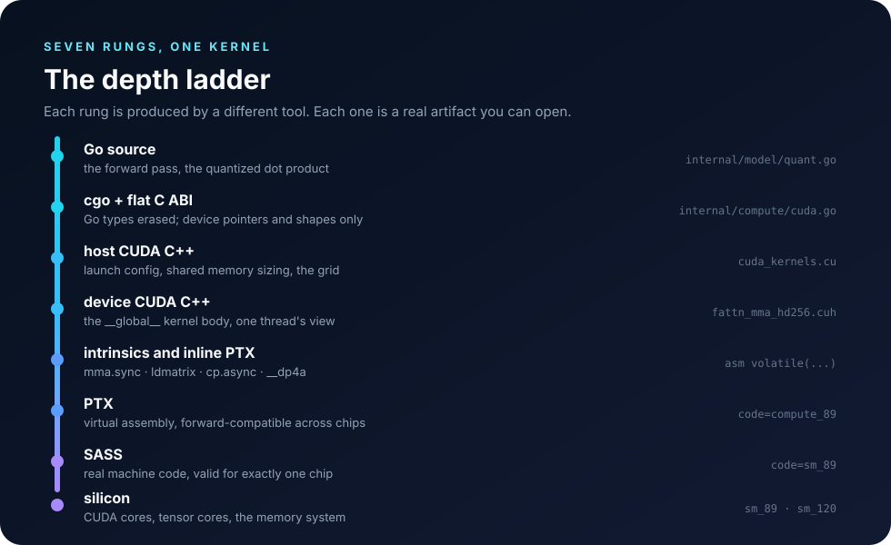

# The GPU instruction set

> **In one breath:** A graphics processor has two languages, not one. The first is virtual
> and portable. The second is real machine code for one exact chip. The driver decides
> which one to use.

**One line:** a graphics processor exposes a virtual instruction set called PTX that is
forward-compatible across chip generations, and a real instruction set called SASS that is
valid for exactly one chip — and the interesting instructions in a modern kernel are not
`add` and `mul` but the ones that move data without touching registers and the ones that
perform a whole small matrix multiply in a single step.

*You are on **Level 3 of 5** of the [fak hardware instruction-set ladder](README.md).*

> **Audience.** You have written or read CUDA. You know what a thread block and a warp are.
> You may not know that a graphics processor has *two* instruction sets, or what
> `mma.sync` is really asking the hardware to do. [Rung 2](level-2-simd-one-instruction-many-numbers.md)
> is the prerequisite for the SIMD idea; this rung assumes it.
>
> **Short answer.** PTX is a virtual assembly that nvcc emits and that a driver can
> re-compile for a chip that did not exist when you built. SASS is the real machine code
> for one `sm_XX` target. Inside a kernel, the instructions that matter are `cp.async`
> (copy global memory to shared memory without going through registers), `ldmatrix` (load
> a matrix in the exact layout the tensor core wants), and `mma.sync` (one instruction,
> 2,048 multiply-adds).



## The question that starts this rung

In [Rung 2](level-2-simd-one-instruction-many-numbers.md) we watched one instruction do
sixteen multiply-accumulates. That felt like a lot.

Here is a single line from fak's flash-attention kernel, at
[`internal/compute/cuda/fattn_mma_hd256.cuh:185`](../../../internal/compute/cuda/fattn_mma_hd256.cuh):

```c
asm("mma.sync.aligned.m16n8k16.row.col.f32.f16.f16.f32 "
    "{%0, %1, %2, %3}, {%4, %5, %6, %7}, {%8, %9}, {%0, %1, %2, %3};"
    : ...);
```

**Checkpoint:** before reading on, guess. How many multiply-adds does that one instruction
perform?

The answer is **2,048**. One instruction. Not sixteen. Two thousand and forty-eight.

And that is not the strangest thing on this page. The strangest thing is that this same
source file, compiled for a different chip, produces *completely different machine code* —
and that this is a feature, not a bug.

## Why would a processor have two instruction sets?

This is the question that makes the rest of the rung make sense, so let us take it
seriously.

Imagine you ship a compiled binary. It contains machine code for one specific chip. A user
buys a newer, faster chip. Your binary does not run, because the machine code is for the
old chip.

That is the situation a graphics processor vendor is in, constantly. New chip generations
ship every year or two. If every binary had to be rebuilt for every new chip, the ecosystem
would be unusable.

So the vendor splits the problem in two:

- **PTX** is a *virtual* instruction set. It is assembly, but it is not any real chip's
  assembly. It is a stable, forward-compatible intermediate. A driver on a newer chip can
  read PTX and compile it to that chip's real instructions.
- **SASS** is the *real* instruction set. It is the actual machine code one specific chip
  executes. It is not portable. It is not documented by the vendor. It is what the silicon
  actually decodes.

**Checkpoint:** which of the two is the "instruction set" in the sense
[Rung 1](level-1-what-is-an-instruction-set.md) defined — the contract the silicon
honours?

SASS. PTX is a promise about what *can* be produced. SASS is what the chip actually runs.

## You can see both in the build

fak's CUDA build makes the two-level structure explicit. From
[`internal/compute/build_cuda.sh:52`](../../../internal/compute/build_cuda.sh):

```bash
GENCODE=(-gencode "arch=compute_${cc},code=${ARCH}")
```

and, in the fat-build branch, at
[`build_cuda.sh:57`](../../../internal/compute/build_cuda.sh) and
[`build_cuda.sh:60`](../../../internal/compute/build_cuda.sh):

```bash
GENCODE+=(-gencode "arch=compute_${cc},code=${arch}")
...
GENCODE+=(-gencode "arch=compute_${PTX_CC},code=compute_${PTX_CC}")
```

Read the two halves of each `-gencode` flag separately. They are doing different jobs:

| Flag | `arch=` (the input) | `code=` (the output) | What it embeds |
|---|---|---|---|
| `arch=compute_89,code=sm_89` | PTX for compute capability 8.9 | SASS for sm_89 | Real machine code, runs only on sm_89 |
| `arch=compute_89,code=compute_89` | PTX for compute capability 8.9 | PTX | Virtual assembly, JIT-compiled by any newer driver |

The first form embeds **SASS**: fast, no compile step at run time, but locked to one chip.
The second form embeds **PTX**: slower to start, because the driver must compile it, but it
runs on chips that did not exist when you built.

A "fat binary" contains both, for several chips. That is why fak's arch list has six
entries. From [`internal/compute/cuda_arch.txt`](../../../internal/compute/cuda_arch.txt):

```
sm_80
sm_89
sm_90
sm_100
sm_103
sm_120
```

And a second file for the opt-in targets, from
[`internal/compute/cuda_arch_specific.txt`](../../../internal/compute/cuda_arch_specific.txt):

```
# Target and opt-in lane nvcc floor. Generic cuda_arch.txt is unchanged.
sm_100a 13.0
sm_103a 13.0
sm_100f 13.0
```

**Checkpoint:** why does the fat build add a `code=compute_XX` PTX entry for only *one* of
the six architectures, rather than all six?

Because PTX is forward-compatible. One PTX blob, compiled for the newest architecture you
support, can be JIT-compiled by any driver at or above that level. You do not need six
copies of the promise. You need one.

## Now: what is actually inside a kernel?

Here is where the rung gets interesting. If you have written CUDA, you have written
something like this:

```c
float acc = 0.0f;
for (int k = 0; k < K; k++) {
    acc += A[row * K + k] * B[k * N + col];
}
```

That is the arithmetic. It is also, on a modern graphics processor, almost none of the
work. The real kernel is dominated by three concerns the loop above hides completely:

1. **Getting data into shared memory without wasting registers on it.**
2. **Getting data into the exact layout the tensor core expects.**
3. **Doing the multiply in a unit that is not the ordinary arithmetic unit.**

Let us take them in order, using fak's real kernel.

## Concern 1: moving data without touching registers

The ordinary way to copy from global memory to shared memory is: load into a register,
then store from the register. That costs a register and a round trip through the
instruction pipeline.

`cp.async` does it without the register. From
[`internal/compute/cuda/fattn_mma_hd256.cuh:210`](../../../internal/compute/cuda/fattn_mma_hd256.cuh):

```c
asm volatile("cp.async.cg.shared.global.L2::64B [%0], [%1], 16;"
    :: "r"(dst), "l"(src));
```

Decode it piece by piece:

| Piece | Meaning |
|---|---|
| `cp.async` | Asynchronous copy. It starts and returns immediately. |
| `.cg` | Cache global. Bypass the L1 cache, go through L2. |
| `.shared.global` | Destination is shared memory, source is global memory. |
| `.L2::64B` | Prefetch hint: pull 64 bytes into L2 while you are at it. |
| `[%0], [%1], 16` | Destination, source, and 16 bytes to move. |

The word **asynchronous** is the important one. The copy is *started*, and the thread
continues. It does not wait. That is how a kernel overlaps memory movement with arithmetic:
issue the copy for the *next* tile while computing on the *current* one.

But asynchronous means you eventually have to synchronize. From
[`fattn_mma_hd256.cuh:219`](../../../internal/compute/cuda/fattn_mma_hd256.cuh):

```c
asm volatile("cp.async.wait_all;");
```

**Checkpoint:** `cp.async` returns immediately. What breaks if you never call
`cp.async.wait_all`?

You read shared memory that has not been written yet. The kernel computes on garbage. This
is the classic asynchronous-copy bug, and it is why the wait is a separate, explicit
instruction rather than something the hardware does for you.

The header comment records that this kernel uses **two** such stages
([`fattn_mma_hd256.cuh:9`](../../../internal/compute/cuda/fattn_mma_hd256.cuh)):

> two cp.async stages, Q kept in registers.

Two stages means: while stage A is being computed on, stage B is being filled. That is
double buffering, and it is the reason the memory system is never idle.

## Concern 2: the layout the tensor core demands

Here is a fact that surprises almost everyone the first time: **the tensor core does not
read memory the way you do.**

A tensor core wants its operands in a specific register layout, distributed across the
threads of a warp in a specific pattern. If your data is in the natural row-major layout,
you cannot just hand it over. You have to rearrange it.

`ldmatrix` is the instruction that does the rearrangement. From
[`fattn_mma_hd256.cuh:139`](../../../internal/compute/cuda/fattn_mma_hd256.cuh):

```c
asm volatile("ldmatrix.sync.aligned.m8n8.x4.b16 {%0, %1, %2, %3}, [%4];"
    : ...);
```

Decode:

| Piece | Meaning |
|---|---|
| `ldmatrix` | Load matrix. |
| `.sync` | All threads in the warp participate together. |
| `.aligned` | All threads must be converged. |
| `.m8n8` | The unit is an 8×8 matrix. |
| `.x4` | Load four of them at once. |
| `.b16` | 16-bit elements. |

So one instruction loads four 8×8 matrices of 16-bit values — 256 values — and distributes
them across the warp in the layout the tensor core expects.

There is also a transposing variant, at
[`fattn_mma_hd256.cuh:154`](../../../internal/compute/cuda/fattn_mma_hd256.cuh):

```c
asm volatile("ldmatrix.sync.aligned.m8n8.x4.trans.b16 {%0, %1, %2, %3}, [%4];"
    : ...);
```

The `.trans` suffix means the loaded matrix is transposed. This exists because the two
operands of a matrix multiply need different orientations, and transposing in the load is
free, while transposing afterwards is not.

**Checkpoint:** why does the hardware care about layout at all? Why not just accept
row-major data?

Because the tensor core is a physical circuit with fixed wiring. Its inputs are specific
wires connected to specific lanes. The layout is not a software convention; it is the shape
of the silicon. `ldmatrix` exists to bridge the gap between how memory is organized and how
the circuit is wired.

## Concern 3: the multiply itself

Now the instruction from the opening. From
[`fattn_mma_hd256.cuh:185`](../../../internal/compute/cuda/fattn_mma_hd256.cuh):

```c
asm("mma.sync.aligned.m16n8k16.row.col.f32.f16.f16.f32 "
    "{%0, %1, %2, %3}, {%4, %5, %6, %7}, {%8, %9}, {%0, %1, %2, %3};"
    : ...);
```

Let us decode the whole mnemonic, because every piece carries information.

**`mma`** — matrix multiply-accumulate. This is the tensor core instruction.

**`.sync`** — the whole warp executes it together. The tensor core is a warp-level unit,
not a per-thread unit.

**`.aligned`** — all threads must be converged on this instruction.

**`.m16n8k16`** — the shape. It computes a 16×8 output tile, from a 16×16 matrix and a
16×8 matrix. The `k` is the shared inner dimension.

**`.row.col`** — the memory layouts of the two input operands. The first is row-major, the
second is column-major.

**`.f32.f16.f16.f32`** — the types, in order: accumulate in f32, first input f16, second
input f16, output f32.

**The operands** — `{%0,%1,%2,%3}` is the output (four f32 registers per thread),
`{%4,%5,%6,%7}` is the first input, `{%8,%9}` is the second, and the trailing
`{%0,%1,%2,%3}` is the accumulator being read and written in place.

Now the arithmetic. A 16×8 output tile, each element of which is a dot product of length
16:

```
16 × 8 × 16 = 2,048 multiply-adds
```

In one instruction. Compare to [Rung 2](level-2-simd-one-instruction-many-numbers.md),
where `VPMADDWD` did 16.

**Checkpoint:** the output is a 16×8 tile, but the instruction names four output registers
per thread. How does a 16×8 = 128-element tile fit in four registers per thread?

Because a warp has 32 threads. 32 threads × 4 registers = 128 values. The tile is
*distributed* across the warp. Each thread holds four of the 128 results. This is the same
distribution idea as `ldmatrix`, and it is why the two instructions are designed as a pair.

### The f16-accumulate variant

There is a second form, at
[`fattn_mma_hd256.cuh:168`](../../../internal/compute/cuda/fattn_mma_hd256.cuh):

```c
asm("mma.sync.aligned.m16n8k16.row.col.f16.f16.f16.f16 {%0, %1}, {%2, %3, %4, %5}, {%6, %7}, {%0, %1};"
    : ...);
```

Same shape, but everything is f16 — including the accumulator. Note the operand count
drops: two output registers instead of four, because f16 values pack two to a register.

Why would you accumulate in f16, which is less precise? Because it is faster and uses half
the registers. And the kernel header tells us exactly where fak makes that trade
([`fattn_mma_hd256.cuh:18`](../../../internal/compute/cuda/fattn_mma_hd256.cuh)):

> Q and the output stay f32 in Fak's [tokens, heads\*256] row-major layout. KQ and the
> softmax statistics accumulate in f32; V\*softmax(KQ) accumulates in f16 (mma
> .f16.f16.f16.f16).

Read that carefully. It is a precision decision made per-operation, not per-kernel. The
attention scores accumulate in f32, because they feed a softmax and precision matters
there. The final weighted sum of values accumulates in f16, because it is the last step and
the error does not compound.

**Checkpoint:** why is it safe to accumulate the *last* operation in lower precision but
not the earlier ones?

Because error compounds. An error in the attention scores propagates through the softmax
and into every subsequent term. An error in the final weighted sum is the last thing that
happens; there is nothing downstream to amplify it.

## The integer path: `dp4a`

Everything so far has been floating point. But most of fak's inference is *quantized* —
the weights are 8-bit or 4-bit integers. For that, there is a different instruction.

From [`internal/compute/cuda_v41_routed_mmid.cu:87`](../../../internal/compute/cuda_v41_routed_mmid.cu):

```c
sumf_d += d8[i] * (__dp4a(vi, u[i], 0) * (sc & 0xF)); // SIMD dot product
```

`__dp4a` is "dot product of 4 8-bit values, accumulate." It takes four int8 values from
each operand, multiplies them pairwise, adds the four products, and adds a third operand as
the accumulator. One instruction, four multiply-adds, in integer.

That is the same idea as ARM's `SDOT` from [Rung 2](level-2-simd-one-instruction-many-numbers.md),
and it is the workhorse of quantized inference on graphics processors. The tensor core
handles the big dense matmuls; `dp4a` handles the quantized paths where the tensor core's
fixed shapes do not fit.

**Checkpoint:** `dp4a` does 4 multiply-adds. `mma.sync` does 2,048. Why does fak use both?

Because they solve different problems. `mma.sync` requires f16 or specific integer shapes
and a specific layout. `dp4a` works on plain int8 arrays in whatever layout you have. When
the data is already in the right shape, use the tensor core. When it is not, `dp4a` is
cheaper than rearranging.

## The payoff: same source, different machine code

Now we can close the loop on the two-instruction-set idea.

fak's kernel source is one file. It compiles to SASS for sm_80, sm_89, sm_90, sm_100,
sm_103, and sm_120 — six different machine codes, from one source. And it also compiles to
one PTX blob that a future driver can JIT.

This is why the arch list exists, and it is why a binary built for sm_89 will not run on
sm_120 without the PTX fallback. The SASS is for one chip. The PTX is the insurance policy.

**Checkpoint:** you build a fat binary with SASS for sm_89 and PTX for compute_89. A user
runs it on sm_120. What happens?

The driver finds no sm_120 SASS, falls back to the compute_89 PTX, and JIT-compiles it for
sm_120 at load time. It works. It is also slower to start, because the compile happens on
the user's machine.

## Try it

**Step 1.** Read the kernel header. It is the best documentation of the design tradeoffs.

```bash
sed -n '1,25p' internal/compute/cuda/fattn_mma_hd256.cuh
```

**Step 2.** Find every tensor-core instruction in the file.

```bash
grep -n "mma.sync\|ldmatrix\|cp.async" internal/compute/cuda/fattn_mma_hd256.cuh
```

**You should see** the three families, and you should be able to say what each one is for
after this rung.

**Step 3.** Look at the arch list and the build flags together.

```bash
cat internal/compute/cuda_arch.txt
sed -n '36,62p' internal/compute/build_cuda.sh
```

**Step 4.** Adjust one input. Pick one architecture out of `cuda_arch.txt` and trace what
`GENCODE` would contain for it. Then trace the fat-build branch. The difference between the
two is the difference between "runs on one chip" and "runs on this chip and every newer
one."

**Checkpoint:** the fat build adds exactly one `code=compute_XX` entry. Which architecture
does it use, and why that one?

It uses the *last* one in the list, because the loop overwrites `PTX_CC` on each iteration
([`build_cuda.sh:58`](../../../internal/compute/build_cuda.sh)). The newest architecture
produces the PTX, because PTX is forward-compatible and one blob covers everything at or
above its level.

## What you should take away

1. A graphics processor has **two** instruction sets. PTX is virtual and forward-compatible.
   SASS is real machine code for one chip.
2. The build embeds both. `code=sm_89` is SASS for one chip; `code=compute_89` is PTX that
   a newer driver JITs.
3. The interesting instructions are not `add` and `mul`. They are `cp.async` (move data
   without registers), `ldmatrix` (rearrange into the tensor core's layout), and `mma.sync`
   (2,048 multiply-adds in one instruction).
4. The tensor core's layout is not a convention. It is the shape of the circuit, which is
   why `ldmatrix` has to exist.
5. Precision is chosen per-operation, not per-kernel. fak accumulates attention scores in
   f32 and the final value sum in f16, because error compounds and the last step has
   nothing downstream.
6. `dp4a` is the integer workhorse for quantized paths, where the tensor core's fixed
   shapes do not fit.

## See also

- [Rung 2 — One instruction, many numbers](level-2-simd-one-instruction-many-numbers.md) —
  the SIMD idea this rung extends from 16 to 2,048.
- [Rung 4 — How the ISA reaches silicon](level-4-how-the-isa-reaches-silicon.md) — the
  driver stack that turns this source into those six machine codes.
- [Rung 5 — Why the ISA is not the whole story](level-5-why-the-isa-is-not-the-whole-story.md) —
  why knowing all of this still does not predict the speed.
- [What is a CUDA kernel?](../what-is-a-cuda-kernel.md) — the depth ladder from Go source
  to silicon, and the three senses of the word "kernel".
- [Multi-GPU tensor parallelism](../multi-gpu-tensor-parallelism.md) — what happens when
  the matmul does not fit on one chip.

---

*[Full ladder (README)](README.md) · prev → [Rung 2 — One instruction, many numbers](level-2-simd-one-instruction-many-numbers.md) · next → [Rung 4 — How the ISA reaches silicon](level-4-how-the-isa-reaches-silicon.md)*
