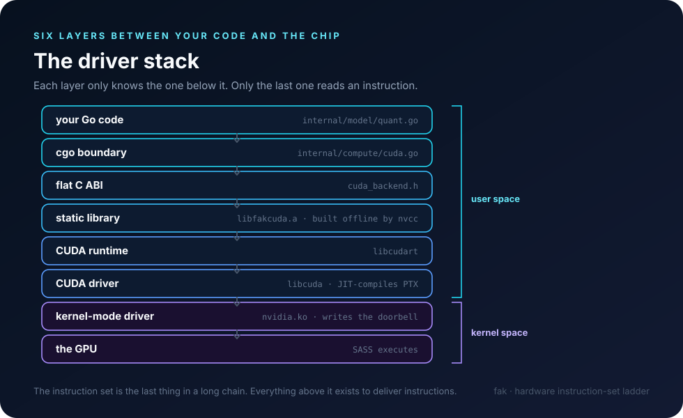

# How the instruction set reaches silicon

> **In one breath:** Your code does not talk to a chip. It talks to a library, which talks
> to a driver, which talks to the chip. Every layer exists to hide the one below it.

**One line:** between a Go function call and a voltage on a graphics processor sit six
layers — cgo, a flat C ABI, a static library, a vendor runtime, a kernel-mode driver, and
the silicon — and each one exists because the layer above it must not know how the layer
below it works.

*You are on **Level 4 of 5** of the [fak hardware instruction-set ladder](README.md).*

> **Audience.** You are a senior engineer. You know what a linker does and you have used
> `cgo` or FFI at least once. You want the whole stack, not the arithmetic.
> [Rung 3](level-3-the-gpu-isa-ptx-sass-and-tensor-cores.md) is the prerequisite: it
> explains what PTX and SASS are. This rung explains how they get to the chip.
>
> **Short answer.** Go calls into C through cgo. The C is a flat ABI with no Go types in it.
> That C is compiled offline by `nvcc` into a static library, which is linked into the Go
> binary. At run time the library calls the CUDA runtime, which calls the CUDA driver,
> which is the only thing that talks to the kernel-mode driver and the chip. The shader
> path is different in one important way: there, the driver compiles your code at run time.



## The question that starts this rung

In [Rung 3](level-3-the-gpu-isa-ptx-sass-and-tensor-cores.md) we read this line:

```c
asm("mma.sync.aligned.m16n8k16.row.col.f32.f16.f16.f32 ...");
```

**Checkpoint:** that is C. fak is a Go program. How does a Go program execute a line of C?

The obvious answer — "it calls a C function" — is right and also hides everything
interesting. There is no C compiler in the shipped `fak` binary. There is no `nvcc` on the
user's machine. And yet the tensor core runs.

So: what is actually in the binary, and what happens when it runs?

## The whole stack, in one picture

Before the details, here is the shape. Read it top to bottom; each layer only knows the
one below it.

```
  your Go code                    internal/model/quant.go
        │  a Go function call
        ▼
  cgo boundary                    internal/compute/cuda.go
        │  a C function call, Go types erased
        ▼
  flat C ABI                      internal/compute/cuda_backend.h
        │  device pointers and shapes, nothing else
        ▼
  static library                  libfakcuda.a  (built offline by nvcc)
        │  a normal function call
        ▼
  CUDA runtime                    libcudart.so
        │  a normal function call
        ▼
  CUDA driver                     libcuda.so
        │  an ioctl
        ▼
  kernel-mode driver              nvidia.ko
        │  a command buffer written to a doorbell register
        ▼
  the GPU                         SASS executes
```

Six layers. Let us walk them.

## Layer 1: cgo — the Go-to-C boundary

fak's CUDA backend is a Go file that is only compiled when you ask for it. From
[`internal/compute/cuda.go:1`](../../../internal/compute/cuda.go):

```go
//go:build cuda && cgo
```

That build tag is doing real work. The header explains why
([`cuda.go:3-8`](../../../internal/compute/cuda.go)):

> It is compiled ONLY under `-tags cuda`; the default `go build ./cmd/fak`
> excludes it entirely, so the shipped artifact stays one pure-Go binary.

**Checkpoint:** why does it matter that the default build excludes this file?

Because the default `fak` binary must run anywhere, with no CUDA installed, no `nvcc`, and
no GPU. If the CUDA code were always compiled in, the binary would need `libcudart` present
just to start. The build tag is what keeps the pure-Go promise intact while still allowing a
GPU build.

The cgo directives are at [`cuda.go:25-30`](../../../internal/compute/cuda.go):

```go
// #cgo CFLAGS: -I${SRCDIR}
// #cgo LDFLAGS: -L${SRCDIR} -lfakcuda -lcudart -lcuda -lcublas -lcublasLt -lstdc++ -lm
// #include <stdlib.h>
// #include "cuda_backend.h"
// #include "cuda_kv_precision.h"
// #include <stdint.h>
```

and the `import "C"` that turns that comment block into a real cgo preamble is at
[`cuda.go:42`](../../../internal/compute/cuda.go).

Read the `LDFLAGS` line as a list of promises the linker must keep:

| Flag | What it links | Which layer |
|---|---|---|
| `-lfakcuda` | `libfakcuda.a` | fak's own kernels, built offline |
| `-lcudart` | `libcudart` | the CUDA runtime |
| `-lcuda` | `libcuda` | the CUDA driver |
| `-lcublas`, `-lcublasLt` | cuBLAS | vendor dense-linear-algebra library |
| `-lstdc++` | the C++ standard library | because the kernels are C++ |
| `-lm` | the math library | `expf`, `sqrtf`, and friends |

**Checkpoint:** `-lstdc++` is in that list. What does that tell you about the kernel source?

That it is C++, not C. And indeed the kernel header says so
([`fattn_mma_hd256.cuh:9`](../../../internal/compute/cuda/fattn_mma_hd256.cuh)): "This
translation unit compiles as C++14." The C ABI at the boundary is C, but the implementation
behind it is C++.

## Layer 2: the flat C ABI — a seam that carries data, never trust

Here is the design decision that makes the whole thing work. From
[`cuda.go:10-13`](../../../internal/compute/cuda.go):

> Every method delegates to the flat C ABI in `cuda_backend.h` (implemented by
> `cuda_kernels.cu`, compiled offline by nvcc into `libfakcuda.a`). The Go side
> re-validates shapes and owns the `Tensor` type; the C side carries only device pointers
> and shapes — a seam that carries data, never trust.

That last clause is the important one. **A seam that carries data, never trust.**

The C side receives raw device pointers and integer shapes. It does not receive Go slices,
Go structs, or Go interfaces. It cannot call back into Go. It cannot allocate Go memory. It
has no idea a garbage collector exists.

**Checkpoint:** why is "never trust" the right posture for this seam?

Because the two sides have different memory models. Go has a moving, garbage-collected heap.
The GPU has device memory that Go's collector knows nothing about. If the C side held a Go
pointer across a call, the collector could move the object and the pointer would dangle. By
restricting the seam to device pointers and plain integers, neither side can corrupt the
other's invariants.

This is also why the Go side re-validates shapes. The C side is not a trusted validator; it
is a fast path. Every shape check happens on the Go side, where the types are real.

## Layer 3: the static library — compiled offline, by a different compiler

The kernels are not compiled when you build `fak`. They are compiled *before*, by `nvcc`,
into a static archive. From [`cuda.go:15-20`](../../../internal/compute/cuda.go):

```bash
nvcc -O3 -arch=sm_89 -c cuda_kernels.cu -o cuda_kernels.o
ar rcs libfakcuda.a cuda_kernels.o
```

Two commands, two tools, two jobs:

- **`nvcc`** is not a normal compiler. It is a *driver* that splits your `.cu` file into host
  code (which goes to the system C++ compiler) and device code (which goes to NVIDIA's
  proprietary backend, producing PTX and SASS). That split is why the file is `.cu` and not
  `.cpp`.
- **`ar rcs`** is the archiver. It bundles object files into a `.a` static library. Nothing
  exotic — the same tool that has been making Unix archives since the 1970s.

**Checkpoint:** why a *static* library rather than a shared one?

Because a static library is just object files glued together. It gets linked into the Go
binary at build time, so there is no `libfakcuda.so` to find at run time, no `LD_LIBRARY_PATH`
to set, no version skew between the library and the binary that uses it. The cost is that
the binary is bigger and must be rebuilt to change a kernel. For a kernel that changes
rarely, that is the right trade.

The build is driven by a single Go program with a deliberate split of responsibilities. The
native driver, `runCUDALegacy` in
[`internal/devcmd/build_cuda_legacy.go`](../../../internal/devcmd/build_cuda_legacy.go)
(reached as `fak-dev build-cuda legacy`), validates the architecture, runs the GPU-free
`check` verb, refuses an incomplete Go toolchain, and then drives `nvcc` (kernel
compilation to `libfakcuda.a`) and the `-tags cuda` go build, test and bench steps.

So the driver does the part that needs no GPU and no compiler first — checking the arch
list and the toolchain — and only then hands the rest to `nvcc` and `go`. That is a pattern
worth noticing: **the portable part is in the portable language.**

The driver's header documents the environment it reads, with the defaults that matter for
the three hosts it runs on: a WSL box with a user-space CUDA env at `~/cudaenv` (the
`CUDA_HOME` fallback), the GPU server, and a GCP GPU VM with CUDA at `/usr/local/cuda`. Hence
the environment variables in
[`build_cuda_legacy.go`](../../../internal/devcmd/build_cuda_legacy.go) (package header,
lines 24-38):

| Variable | Meaning |
|---|---|
| `FAK_CUDA_ARCH` | `sm_89`, `sm_90`, `sm_100`, `sm_120` — or unset for a fat build |
| `FAK_CUDA_V41` | sm_120 only: skip the default device-witnessed V4.1 tags |
| `FAK_CUDA_NCCL` | also compile `cuda_nccl.cu`; Go tags `cuda,nccl` |
| `CUDA_HOME` | where the toolkit lives; defaults to `~/cudaenv` |
| `NCCL_HOME` | where NCCL lives; defaults to `/tmp/nccl-root` |

**Checkpoint:** `FAK_CUDA_ARCH` unset means "fat build of every line in `cuda_arch.txt` plus
PTX." Why is that the default rather than a single arch?

Because the default must work on whatever machine the user has. A fat binary carries SASS
for six chips and one PTX blob, so it runs on all of them. Picking one arch is an
optimization for a known target, not a safe default.

## Layer 4: the CUDA runtime — the friendly layer

`libcudart` is the CUDA *runtime* API. It is the layer that gives you `cudaMalloc`,
`cudaMemcpy`, and `cudaLaunchKernel`.

It is a convenience layer, and it is worth being precise about what it is convenient
*about*. The runtime API does three things the driver API does not:

1. **It initializes the context for you.** The driver API requires you to create a context
   explicitly. The runtime does it lazily on first use.
2. **It manages device memory for you.** `cudaMalloc` is a caching allocator, not a raw
   allocation.
3. **It handles module loading.** You hand it a kernel function pointer; it figures out
   which loaded module that belongs to.

**Checkpoint:** if the runtime is just a convenience wrapper, why does fak link *both*
`-lcudart` and `-lcuda`?

Because they are not redundant. The runtime is built on top of the driver, and some
operations — particularly the ones that need to know about the physical device, or that
manage contexts explicitly — are only available in the driver API. Linking both is normal
for a serious CUDA application.

## Layer 5: the CUDA driver — the only thing that talks to the kernel

`libcuda` is the CUDA *driver* API. It is the boundary between user space and kernel space.

This is the layer that matters most for the question "how does the instruction set reach
silicon," because it is where the crossing happens. Everything above it is a normal library
call in your process. Everything below it is a different privilege level.

The driver does three things that nothing above it can do:

1. **It owns the device.** It is the only component that can submit work to the GPU.
2. **It JIT-compiles PTX.** When the fat binary has no SASS for the current chip, the driver
   compiles the PTX at load time. This is the mechanism from
   [Rung 3](level-3-the-gpu-isa-ptx-sass-and-tensor-cores.md).
3. **It manages memory translation.** Device memory is not in your process's address space
   in the ordinary sense. The driver sets up the mappings.

**Checkpoint:** the driver JIT-compiles PTX. Where does that compilation happen — in your
process, or somewhere else?

In your process, in user space, inside `libcuda`. The *result* is handed to the kernel-mode
driver, but the compilation itself is ordinary user-space work. That is why a JIT compile
shows up as startup latency in your own process rather than as a system-wide event.

## Layer 6: the kernel-mode driver and the silicon

Below `libcuda` is `nvidia.ko` — a kernel module. It runs at the highest privilege level on
the machine. It is the only code that can program the GPU's hardware queues.

The mechanism is worth stating plainly, because it is the answer to the rung's question:

1. The user-space driver writes a **command buffer** — a list of GPU commands, including
   which kernel to run and with what arguments.
2. It writes the buffer's address to a **doorbell register** — a specific memory-mapped
   location on the device.
3. The GPU's command processor sees the doorbell, fetches the buffer, and begins dispatching
   work to its execution units.
4. The execution units fetch SASS instructions and decode them.

**Checkpoint:** at which of those four steps does the instruction set finally matter?

Step 4. Steps 1 through 3 are about *getting work to the chip*. Only at step 4 does the chip
read an instruction and act on it. This is the whole point of the rung: the instruction set
is the last thing in a long chain, and everything before it exists to deliver instructions
to a place where they can be executed.

## The other path: shaders, where the driver compiles at run time

Everything above describes the CUDA path. fak also runs on Vulkan and Metal, and those paths
are architecturally different in one important way.

On the CUDA path, the kernel is compiled **before** the program ships. On the shader path,
the shader is compiled **at run time**, by the driver, on the user's machine.

Here is fak's Vulkan shader build. From
[`internal/computebuild/vulkan_shaders.go:18`](../../../internal/computebuild/vulkan_shaders.go):

```go
args := []string{"-O", "--target-env=vulkan1.2", "-fshader-stage=comp", src, "-o", dst}
```

That is a call to `glslc`, the shader compiler. Decode the flags:

| Flag | Meaning |
|---|---|
| `-O` | optimize |
| `--target-env=vulkan1.2` | target the Vulkan 1.2 environment |
| `-fshader-stage=comp` | this is a compute shader |
| `src`, `-o`, `dst` | input `.comp` file, output `.spv` file |

The output is **SPIR-V** — Standard Portable Intermediate Representation. And here is the
key fact: **SPIR-V is to Vulkan what PTX is to CUDA.** It is a virtual instruction set. It is
not any chip's machine code. The driver compiles it to real machine code for the actual GPU.

**Checkpoint:** SPIR-V and PTX are both virtual instruction sets. Why would two ecosystems
independently invent the same idea?

Because they face the same problem. A shader author cannot know which GPU will run their
shader. A GPU vendor cannot ship a compiler for every shader ever written. A virtual
instruction set is the interface that lets both sides stop worrying about the other. The
idea is not a CUDA quirk; it is the standard solution to the problem of portable device code.

fak's shader source is GLSL. From
[`internal/compute/shaders/q8_matmul.comp:1`](../../../internal/compute/shaders/q8_matmul.comp):

```glsl
#version 450
```

and the extensions it needs, at
[`q8_matmul.comp:2-7`](../../../internal/compute/shaders/q8_matmul.comp):

```glsl
#extension GL_KHR_cooperative_matrix : enable
#extension GL_KHR_memory_scope_semantics : enable
#extension GL_KHR_shader_subgroup_basic : enable
#extension GL_EXT_shader_explicit_arithmetic_types_int8 : require
#extension GL_EXT_shader_explicit_arithmetic_types_int32 : require
#extension GL_EXT_shader_8bit_storage : require
```

**Checkpoint:** `GL_KHR_cooperative_matrix` is in that list. What does that extension give
you, in the vocabulary of [Rung 3](level-3-the-gpu-isa-ptx-sass-and-tensor-cores.md)?

Tensor cores. "Cooperative matrix" is the Vulkan name for the same hardware idea as
`mma.sync`: a matrix multiply performed cooperatively by a group of threads, using a
dedicated matrix unit. The header of the shader says so directly
([`q8_matmul.comp:9-31`](../../../internal/compute/shaders/q8_matmul.comp)): "Wave32 WMMA
16x16x16 INT8 in two 16-element halves accumulating into int32."

So the same silicon is reachable from two completely different software stacks, and the
instruction that drives it has a different name in each.

### The same shader, installed on a device

There is a second place fak compiles shaders, and it is worth seeing because it shows the
same command in a deployment context. From
[`internal/amdgpu/strixinstaller.go:569`](../../../internal/amdgpu/strixinstaller.go):

```go
glslc -O --target-env=vulkan1.2 -fshader-stage=comp "$shader" -o "/var/lib/fak/spirv/${sname}.spv"
```

Same flags, different destination: `/var/lib/fak/spirv/`. The shaders are compiled on the
target machine and installed as `.spv` files.

**Checkpoint:** the CUDA path compiles kernels at *build* time; this path compiles shaders at
*install* time. Why the difference?

Because the CUDA path links a static library into a Go binary, and the shader path does not.
A `.spv` file is a separate artifact that the Vulkan driver loads at run time. There is no
linker step to hang the compilation off, so it happens when the files are installed.

### Metal: the same idea, a different language

fak's Metal backend has three shaders, in
[`internal/compute/metal/`](../../../internal/compute/metal): `doorbell_ar.metal`,
`hashk_gather.metal`, and `wyf_gdn.metal`.

The `.metal` extension is Apple's shading language. It is compiled by Apple's toolchain into
a `.metallib`, which the Metal driver loads. Same three-layer shape as Vulkan — source,
intermediate, machine code — with different names at every level.

One of them is worth a look because it is not a matmul at all. From
[`doorbell_ar.metal:1-8`](../../../internal/compute/metal/doorbell_ar.metal):

> Stream-Async GPU-Doorbell Direct RDMA all-reduce over USB4/Thunderbolt; XINNOV-03; GPU
> thread 0 in each threadgroup acquire-spins on the peer arrival flag in
> `MTLResourceStorageModeShared` memory.

**Checkpoint:** that shader does an all-reduce over Thunderbolt. What is the "doorbell" it
names, and where have you seen that word already in this rung?

It is the same doorbell as the GPU command doorbell in layer 6 — a memory location one side
writes to signal the other. Here it is used for peer-to-peer communication between two GPUs
over a cable, rather than for host-to-device command submission. The pattern is the same:
**write a flag, let the other side poll it.** That is what a doorbell is, everywhere.

## The AMD path: assembly, not a shader language

There is one more path, and it is the most direct of all. fak has a hand-written AMDGPU
assembly kernel. From
[`internal/compute/strix/asm_gfx1151.s:12`](../../../internal/compute/strix/asm_gfx1151.s):

```
.amdgcn_target "amdgcn-amd-amdhsa--gfx1151"
```

That is a real assembly file, targeting one specific AMD chip — GFX1151, the integrated GPU
in a Ryzen AI Max+ 395. The header states the design constraint
([`asm_gfx1151.s:3-10`](../../../internal/compute/strix/asm_gfx1151.s)):

> Invariant: Zero intermediate LDS (Local Data Share) buffer allocations; all packed 4-bit
> and 8-bit weight streams loaded via 128-bit `global_load_dwordx4`, matching 4x 128-byte
> coalesced LPDDR5X bursts across Wave32.

And the matrix instruction, at
[`asm_gfx1151.s:90`](../../../internal/compute/strix/asm_gfx1151.s):

```
v_wmma_f32_16x16x16_f16 v[16:23], v[8:11], v[28:29], v[16:23]
```

**Checkpoint:** compare that to `mma.sync.aligned.m16n8k16.row.col.f32.f16.f16.f32` from
[Rung 3](level-3-the-gpu-isa-ptx-sass-and-tensor-cores.md). What is the same, and what is
different?

Same: a matrix multiply-accumulate on a dedicated unit, with a shape encoded in the mnemonic
(16×16×16 here, 16×8×16 there), f16 inputs and f32 accumulate. Different: the vendor, the
mnemonic, the register syntax, and the shape. **The hardware idea is universal; the
instruction set is not.** That is the single most important thing this ladder teaches.

## Try it

**Step 1.** See the build tag do its job. Build without the tag and confirm the CUDA file is
not in the binary.

```bash
go build -o /tmp/fak-plain ./cmd/fak
go version -m /tmp/fak-plain | grep -i cuda || echo "no cuda in the default build"
```

**You should see** no CUDA dependency. That is the pure-Go promise holding.

**Step 2.** Read the cgo directives and the ABI comment together.

```bash
sed -n '1,30p' internal/compute/cuda.go
```

**Step 3.** Read the build driver's header and its environment block.

```bash
sed -n '1,38p' internal/devcmd/build_cuda_legacy.go
```

**Step 4.** Adjust one input. Set `FAK_CUDA_ARCH=sm_89` and trace what `GENCODE` contains.
Then unset it and trace the fat-build branch. The difference is the difference between "runs
on one chip" and "runs on six chips plus every future one."

**Step 5.** Find every place fak invokes a shader compiler.

```bash
grep -rn "glslc" internal/ | head
```

**You should see** the build-time call in `computebuild/` and the install-time call in
`amdgpu/`. Two call sites, one command, two different moments in the lifecycle.

## What you should take away

1. Six layers sit between a Go call and a voltage: cgo, a flat C ABI, a static library, the
   vendor runtime, the driver, and the kernel-mode driver.
2. The C ABI is deliberately narrow — device pointers and shapes only. **A seam that carries
   data, never trust.**
3. The kernels are compiled *offline* by `nvcc` into a static archive, so the shipped binary
   needs no compiler and no shared library.
4. The driver is the only layer that crosses into kernel space, and it is the layer that
   JIT-compiles PTX when no SASS matches the chip.
5. The shader path inverts the timing: SPIR-V and Metal shaders are compiled at run time or
   install time, not build time. SPIR-V is to Vulkan what PTX is to CUDA.
6. The same hardware idea — a cooperative matrix multiply — appears as `mma.sync` on NVIDIA,
   `v_wmma` on AMD, and `GL_KHR_cooperative_matrix` on Vulkan. The idea is universal; the
   instruction set is not.

## See also

- [Rung 3 — The GPU instruction set](level-3-the-gpu-isa-ptx-sass-and-tensor-cores.md) — what
  PTX and SASS are, and what the driver is JIT-compiling.
- [Rung 5 — Why the ISA is not the whole story](level-5-why-the-isa-is-not-the-whole-story.md) —
  why all of this still does not predict the speed.
- [What is a CUDA kernel?](../what-is-a-cuda-kernel.md) — the depth ladder this rung walks,
  and the three senses of the word "kernel".
- [Hardware portability](../hardware-portability.md) — the HAL seam that lets one forward
  pass run on four different machines.
- [The hardware matrix](../../HARDWARE-MATRIX.md) — every platform fak has measured, with the
  instruction sets and backends each one uses.

---

*[Full ladder (README)](README.md) · prev → [Rung 3 — The GPU instruction set](level-3-the-gpu-isa-ptx-sass-and-tensor-cores.md) · next → [Rung 5 — Why the ISA is not the whole story](level-5-why-the-isa-is-not-the-whole-story.md)*
