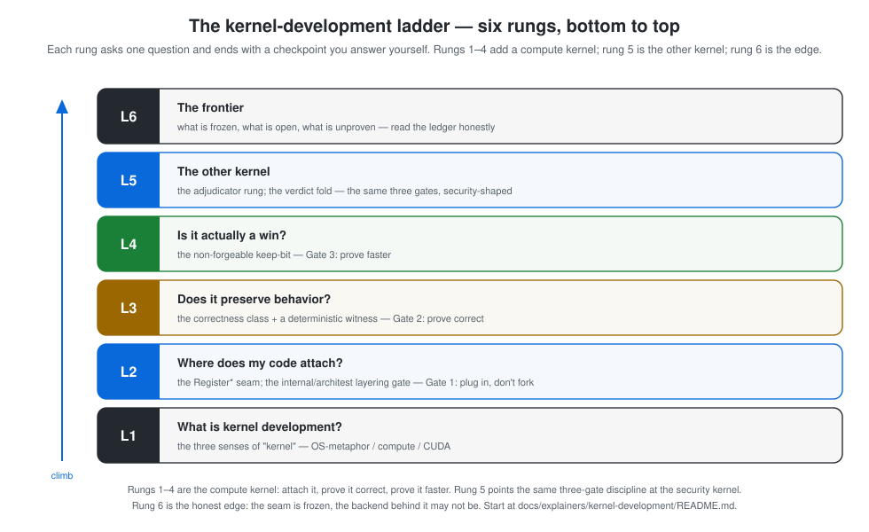
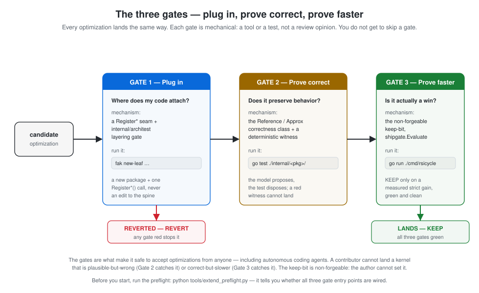

# The fak kernel-development ladder

> **What this is.** The same subject — how you change fak's kernel without forking it —
> written **six times**, once for each kind of reader. Each rung is pitched at both a
> human audience *and* a model/agent capability tier: a newcomer is served at Level 1; a
> frontier-tier reader is served at Level 6. Pick your rung, or climb the whole ladder.

"Kernel development" in this repo means one specific practice: **changing the code the
kernel walks, without editing the spine.** fak is a frozen minimal spine
(`internal/abi`) plus real extension seams, so a new idea is a new package plus one
`Register*()` call — never an edit to the core. That single sentence is the whole
subject; the six rungs are the six depths at which you can understand it.

A single flat page either loses the beginner or bores the expert. This ladder splits the
difference: each rung assumes exactly what the one below it taught.

## The six rungs

| Level | Who it's for | What you'll get |
|---|---|---|
| **[1 · What is kernel development?](level-1-what-is-kernel-development.md)** | A newcomer who has hit the word "kernel" in three places and cannot reconcile them. No systems background assumed. | The three senses of "kernel", what the *practice* is, and the one idea: a frozen spine plus real seams. |
| **[2 · The registration seam](level-2-the-registration-seam.md)** | A competent dev or mid-tier agent asking "where does my code attach?" | The `Register*()` seams by name, the `architest` layering gate, and the file-tree disjointness that lets two workers build at once. |
| **[3 · Prove correct](level-3-prove-correct.md)** | An engineer who has attached a kernel and must show it preserves behavior. | The Reference/Approx correctness class and the deterministic witness that decides it. |
| **[4 · Prove faster](level-4-prove-faster.md)** | An engineer whose kernel is correct and now must earn the right to land. | The non-forgeable keep-bit, the honest baseline, and KEEP vs REVERT. |
| **[5 · The adjudicator rung](level-5-the-adjudicator-rung.md)** | A security-minded reader who wants the *other* kernel — the one that decides whether a tool call may run. | The verdict fold, the real rung chain, and how to add an admission check. |
| **[6 · The frontier](level-6-the-kernel-development-frontier.md)** | A frontier-tier reader / researcher who wants the honest edge. | Which seams are frozen, which gates block, and what the repo does *not* yet prove. |

## The whole ladder in one picture

```
   L1  What is kernel development?      ── the three senses of "kernel"
        │                                   (OS-metaphor / compute / CUDA)
        ▼
   L2  Where does my code attach?       ── the Register* seam; architest layering gate
        │                                   (Gate 1: plug in, don't fork)
        ▼
   L3  Does it preserve behavior?       ── the correctness class + a deterministic witness
        │                                   (Gate 2: prove correct)
        ▼
   L4  Is it actually a win?            ── the non-forgeable keep-bit
        │                                   (Gate 3: prove faster)
        ▼
   L5  The other kernel                 ── the adjudicator rung; the verdict fold
        │                                   (the same three gates, security-shaped)
        ▼
   L6  The frontier                     ── what is frozen, what is open, what is unproven
                                            (read the ledger honestly)
```



Rungs 1–4 are one continuous path: understand the word, attach at a seam, prove correct,
prove faster. Rung 5 is the same discipline pointed at the security kernel instead of the
compute kernel. Rung 6 is not a new mechanism at all — it is the honest edge of what the
repo has proven.

## What each rung assumes

Each rung assumes exactly what the one below it taught, so you can join at any rung whose
assumptions you already meet.

| Rung | Assumes you can already… |
|---|---|
| 1 | — (start cold) |
| 2 | say what a kernel is and why the spine is frozen |
| 3 | name the seam your idea attaches to |
| 4 | show your kernel preserves behavior |
| 5 | read a `Register*()` call and a registry walk |
| 6 | name the three gates and the two kernels |

## How to read it

- **Just want to understand the word?** Read **Level 1** and stop. That is the whole
  conceptual story.
- **Want to add a compute kernel (a quantization path, a GPU backend)?** Read **Level 1**,
  then **Level 2** (attach), **Level 3** (prove correct), **Level 4** (prove faster).
  That is the three-gate golden path.
- **Want to add a security check instead of a compute kernel?** Read **Level 1**, then
  **Level 5**. It is the same three-gate discipline, pointed at a different question.
- **Deciding whether to build at all?** Read **Level 6** first — it tells you which seams
  are frozen and which are still moving.

Each rung ends with a nav footer linking its neighbours and back here.

## The three gates, in one table

Every optimization lands the same way, and the middle four rungs are the gates. Each gate
is mechanical — a tool or a test, not a review opinion.

| Gate | Question | The mechanism | The rung that teaches it |
|---|---|---|---|
| **1. Plug in** | Where does my code attach? | a `Register*` seam + the `internal/architest` layering gate | [Level 2](level-2-the-registration-seam.md) |
| **2. Prove correct** | Does it preserve behavior? | the Reference/Approx correctness class + a deterministic witness | [Level 3](level-3-prove-correct.md) |
| **3. Prove faster** | Is it actually a win? | the non-forgeable keep-bit (`shipgate.Evaluate` via `cmd/rsicycle`) | [Level 4](level-4-prove-faster.md) |



You do not get to skip a gate. That is the point: a contributor cannot land a kernel that
is plausible-but-wrong (Gate 2 catches it) or correct-but-slower (Gate 3 catches it). The
gates are what make it *safe* to accept optimizations from anyone — including autonomous
coding agents.

## The vocabulary the ladder uses

Six words recur on every rung. Learn them here and the rungs read faster.

| Word | What it means |
|---|---|
| **spine** | `internal/abi` — the frozen shared vocabulary every leaf imports. Never edited after freeze. |
| **leaf** | One package under `internal/`, in its own directory, with its own lane. A new idea is a new leaf. |
| **seam** | A named `Register*()` call a leaf attaches through. The kernel walks the registry; it never imports the leaf. |
| **rung** | One link in the security kernel's ranked adjudicator chain (Level 5's sense of the word). |
| **gate** | A mechanical check a change must clear: plug in, prove correct, prove faster. |
| **witness** | A deterministic, re-runnable artifact that decides a gate — not a claim the author makes. |

## What this ladder is not

- It is **not** a CUDA tutorial. If you want the literal `__global__` sense of "kernel",
  read [What is a CUDA kernel?](../what-is-a-cuda-kernel.md) first; this ladder is about
  the *practice* of changing fak's kernel, whichever sense you mean.
- It is **not** a serving guide. fak does not chase vLLM on raw tokens/sec; the honest
  serving boundary is [what fak is not](../what-fak-is-not.md).
- It is **not** a promise that every seam is finished. Level 6 is the rung that tells you
  which seams are frozen and which are still moving.

## Questions this ladder answers

- Where does my code attach to the kernel?
- What is a `Register*()` call, and who calls it?
- Why can't I just edit the core and add my feature there?
- How do I know my kernel is *correct*, not just plausible?
- How do I know my kernel is *faster*, not just different?
- Is the "agent kernel" the same thing as a CUDA kernel?
- What is a **rung**, and what is a **verdict fold**?
- What stops two workers from colliding on the same files?
- What does the layering gate refuse, and what is the fix?
- Which seams are frozen, and which are still moving?
- What does the repo *not* yet prove about kernel development?
- Where do I go to actually build something?

## See also

- [What is a CUDA kernel?](../what-is-a-cuda-kernel.md) — the three-senses
  disambiguation Level 1 builds on.
- [The abstraction map](../the-abstraction-map.md) — how the layers are named, floor by
  floor, from your terminal to the silicon.
- [The tool call is a syscall](../tool-call-is-a-syscall.md) — the keystone idea behind
  the security kernel Level 5 covers.
- [Policy in the kernel](../policy-in-the-kernel.md) — where the admission rungs live.
- [`EXTENDING.md`](../../../EXTENDING.md) — the task-first golden path: plug in → prove
  correct → prove faster → ship.
- [`ARCHITECTURE.md`](../../../ARCHITECTURE.md) — the frozen ABI, the seam catalog, and
  the scaling contract, in full.
