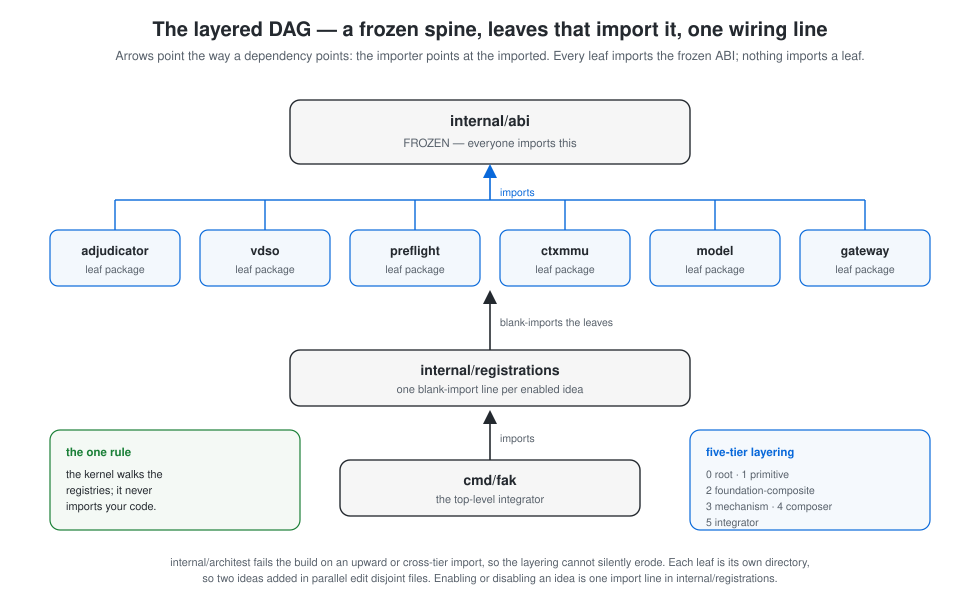

# Level 1 — What is kernel development?

*You are on **Level 1 of 6** of the [kernel-development ladder](README.md).*

> **What this is.** The newcomer's rung. You have hit the word "kernel" in three places
> in this repo and they cannot possibly mean the same thing. This page pins each sense to
> the file that embodies it, then says precisely what **kernel development** is as a
> *practice*: changing the code the kernel walks, without forking the spine. By the end
> you can name the one idea — a frozen minimal spine plus real extension seams — and
> point at the seam your own idea would attach to.

## Questions this page answers

- What does "kernel" mean here — and why does it mean three things?
- Is the agent kernel the same as a CUDA kernel?
- What is "kernel development" as a *practice*, in one sentence?
- What is the "spine", and why is it frozen?
- What is a "seam", and how is it different from editing the core?
- How do I see the seams for myself, with no GPU and no API key?
- If I wanted to add a new quantization kernel, which seam and which gate?

## What does "kernel" mean here?

Three unrelated machines share one word. This is the same disambiguation as
[What is a CUDA kernel?](../what-is-a-cuda-kernel.md), pinned to the file that embodies
each sense:

| Sense | What it is | Where it lives here | Runs on |
|---|---|---|---|
| **OS-metaphor kernel** — fak as reference monitor | The trust boundary that adjudicates every tool call: the model proposes, the kernel disposes. Borrowed from operating systems, where the kernel is the code user programs cannot bypass. | `internal/adjudicator`, `internal/kernel` (the verdict fold) | Plain CPU, pure Go. **No GPU involved.** |
| **Compute kernel** — the HPC sense | The inner-loop math routine an operation dispatches to; "which arithmetic does this matmul run through?" | `matKernel` in `internal/model/kernel.go` — the f32 vs Q8 arithmetic paths share one block skeleton | Host CPU (Go), orchestrating the forward pass |
| **CUDA kernel** — the literal NVIDIA sense | A `__global__` function launched onto the GPU, executed by thousands of threads at once | `internal/compute/cuda_kernels.cu` and the focused modules under `internal/compute/cuda/*.cuh` | The GPU itself |

The three never overlap: no GPU code participates in a tool-call verdict, and the
reference monitor never touches the forward pass. When a fak doc says "in-kernel",
context decides which machine it means.

## So what is "kernel development" as a practice?

Here is the sentence to keep:

> **Kernel development is changing the code the kernel *walks*, without forking the
> spine.**

Unpack it. The kernel does not contain your feature. It holds a small interface, walks a
registry of implementations, and calls a method on each. Your job is to *add an
implementation to that registry* — not to reach into the kernel and add a `case` to a
switch. That is the whole practice, and it is the same practice whether the kernel in
question is the security one (a new admission rung) or the compute one (a new
quantization path).

## The one idea: a frozen minimal spine + real extension seams

fak is built as a **stable minimal spine with real extension seams**. The spine is
`internal/abi` — the shared vocabulary of tool calls, verdicts, and refs that every leaf
and every command depends on. It is **frozen**: it does not change after freeze, because
it is the one tree every worker imports, and an edit to it collides everyone.

Everything else attaches as *a new package + one `Register*()` call*, never an edit to
the core. The kernel **walks** the registries; it never imports a driver.



```
                       internal/abi   (FROZEN — no worker may lease it)
                      /   |   |   |   \
   adjudicator vdso preflight ctxmmu model gateway recall ... (leaves)
                      \   |   |   |   /
                   internal/registrations  (blank-imports the built-in leaves)
                              |
                           cmd/fak
```

Read the picture bottom-up. `cmd/fak` is the binary you run. It imports
`internal/registrations`, whose only job is a list of blank imports — one line per
built-in leaf — so that each leaf's `init()` runs and registers itself against the frozen
ABI before the kernel boots. The leaves sit below, each in its **own directory**. The
spine sits at the top, imported by all of them and importing nothing internal.

The leaves form a **layered DAG**, not a star: a leaf may import lower-tier leaves, never
a higher tier. `internal/architest` fails the build on an upward import. The five tiers,
from the gate's own table:

| Tier | Name | Rule |
|---|---|---|
| 0 | `root` | frozen ABI; imports nothing internal |
| 1 | `primitive` | pure libraries; import only root |
| 2 | `foundation-composite` | foundational helpers assembled from primitives |
| 3 | `mechanism` | single-purpose kernel mechanisms and engines |
| 4 | `composer` | workflows composed from mechanisms |
| 5 | `integrator` | top-level wiring, gateways, and registrations |

Because each leaf is its **own directory**, two ideas added in parallel by two workers
edit **disjoint files** and cannot collide. That is a property of the file tree, not the
import graph — and it is what makes a fleet of workers able to build N leaves at once.

## How does a new idea actually bake in?

A driver package registers itself from its own `init()` against `internal/abi`. The
kernel never imports the driver; it walks the registry and calls the method.

```
  your package                 the frozen spine                 the kernel
  ------------                 ----------------                 ----------
  internal/myidea/             internal/abi/registry.go         internal/kernel
    func init() {   ──────►      RegisterAdjudicator(rank, me)      │
      abi.RegisterAdjudicator(   └─ appends to reg.adjudicators     │
        rank, myRung{})          └─ rebuildSnapshot()  ──────►   abi.AdjudicatorsFor(call)
    }                                                              │
                                                                   ▼
  the kernel NEVER imports internal/myidea.            your code runs, in rank order,
  It walks the registry and calls your method.         as one link in the fold.
```

The arrow is the whole point: **the kernel never imports your code.** It holds an
interface, walks a slice, and calls a method. Your package can be added or replaced by
one import line; the kernel's source does not change.

## Predict, then run: see the seams for yourself

No GPU, no API key, no model. Two commands. Predict each result before you run it.

**Command 1 — the scaffolder's help.** I expect it to exist and print a usage block with
the flags `-tier`, `-register`, `-summary`, `-dry-run`, `-suggest-tier`, `-workspace`.

```bash
go run ./cmd/fak new-leaf --help
```

**What actually happened** (run on this host, 2026-11-18):

```
Usage of new-leaf:
  -dry-run
    	print the planned edits without writing files
  -register
    	add the leaf to the defconfig blank-import list
  -suggest-tier string
    	read-only: print the minimum-correct tier for an existing internal leaf derived from its imports, then exit
  -summary string
    	one-line package summary for doc.go
  -tier string
    	layering tier: primitive, foundation-composite, mechanism, composer, or integrator
  -workspace string
    	workspace root (defaults to current directory)
```

The prediction held. Note the flag order: `fak new-leaf` takes the package name as a
positional argument, so flags must come **before** it. A dry run shows which files a new
leaf would touch — and that list *is* the seam model in one screen:

```bash
go run ./cmd/fak new-leaf --tier mechanism --summary "demo leaf" --dry-run demoleaf
```

```
"edits": ["internal/demoleaf/doc.go", "internal/demoleaf/demoleaf.go",
  "internal/demoleaf/demoleaf_test.go",
  "internal/architest/architest_test.go (tier table)",
  "dos.toml (concurrency lane)"]
```

A new directory, a tier declaration, and one lane row. Nothing in the spine.

**Command 2 — the layering gate.** I expect the layering checks to pass; the tree is
green today.

```bash
go test ./internal/architest/ -run 'TestNoUpwardImports|TestEveryPackageDeclaresTier|TestHotPathHasNoExec' -count=1
```

**What actually happened** (run on this host, 2026-11-18):

```
ok  	github.com/anthony-chaudhary/fak/internal/architest	5.638s
```

The prediction held. One honest caveat: running the *whole* package
(`go test ./internal/architest/ -count=1`) comes back **FAIL** on this host — but not on
the layering gate. The red is `TestSBOMDriftGateCatchesMutations`, an SBOM-drift check
that lives in the same package and is unrelated to layering. **A package-level red is not
necessarily your gate's red.** Read the failing test's name before you conclude your
change broke the architecture.

## Worked example: "I want to add a new quantization kernel"

Trace it from idea to gate. This is the most common research optimization, and it is the
one `EXTENDING.md` uses as its worked example.

| Step | The question | The answer |
|---|---|---|
| 1. Which sense of "kernel"? | Is this the security kernel or the compute kernel? | The **compute** kernel — the arithmetic a matmul runs through. |
| 2. Which seam? | Where does my code attach? | `compute.Register(Backend)` in `internal/compute/compute.go` — a new **file** in `internal/compute/` that self-registers in `init()`. |
| 3. Which interface? | What do I implement? | The small whole-op `Backend` interface: `MatMul`, `BatchedMatMul`, `RMSNorm`, `RoPE`, `SwiGLU`, `Attention`, `Argmax`, plus `Upload`/`Read`/`NewKV` for residency. |
| 4. Which correctness class? | Am I bit-exact or approximate? | **`Approx`** — a quantized path is held to argmax-exact plus a declared logit-cosine threshold, not to `max|Δ|=0`. (The pure-Go `cpu-ref` backend declares `Reference`.) |
| 5. Gate 1 — plug in | Does it attach without forking? | A new file + one `init()`; `internal/architest` keeps the layering green. |
| 6. Gate 2 — prove correct | Does it preserve behavior? | A deterministic witness test in the package; the harness enforces the declared class. |
| 7. Gate 3 — prove faster | Is it actually a win? | The non-forgeable keep-bit (`shipgate.Evaluate` via `cmd/rsicycle`) — KEEP only on a measured strict gain. |

The first four rows are this rung. Rows 5–7 are rungs 2, 3, and 4 of this ladder. You do
not get to skip a gate — that is what makes it safe to accept an optimization from
anyone, including an autonomous agent.

## Checkpoint

Answer these to certify yourself before climbing to Level 2.

1. Name the three senses of "kernel" in this repo and the file that embodies each.
2. State what "kernel development" is as a practice, in one sentence.
3. What is the spine, and why is it frozen?
4. What does a `Register*()` call do, and who calls it?
5. For a new quantization kernel: which seam, which correctness class, and which gate
   proves it earns its keep?

### Answers

1. **OS-metaphor** (the reference monitor) — `internal/adjudicator` / `internal/kernel`;
   **compute** (the HPC inner-loop routine) — `matKernel` in `internal/model/kernel.go`;
   **CUDA** (a `__global__` function) — `internal/compute/cuda_kernels.cu` and
   `internal/compute/cuda/*.cuh`.
2. Changing the code the kernel *walks*, without forking the spine — a new package plus
   one `Register*()` call, never an edit to the core.
3. `internal/abi`, the shared vocabulary every leaf and command imports. It is frozen
   because an edit to it collides every worker and forces a fleet-wide recompile.
4. It appends your driver to a registry from your package's `init()`, then rebuilds one
   immutable snapshot. The kernel walks the registry and calls your method; it never
   imports your package.
5. The seam is `compute.Register(Backend)` — a new file in `internal/compute/`. The class
   is `Approx`. The gate is the non-forgeable keep-bit (Gate 3, `shipgate.Evaluate` via
   `cmd/rsicycle`), after Gate 2's correctness witness.

## See also

- [Level 2 — The registration seam](level-2-the-registration-seam.md): the seams by name,
  the layering gate, and the file-tree disjointness that lets two workers build at once.
- [What is a CUDA kernel?](../what-is-a-cuda-kernel.md) — the full three-senses
  disambiguation this rung builds on.
- [The abstraction map](../the-abstraction-map.md) — how the layers are named, floor by
  floor.
- [`EXTENDING.md`](../../../EXTENDING.md) — the three gates and the seam table.
- [`ARCHITECTURE.md`](../../../ARCHITECTURE.md) — the frozen ABI and the seam catalog.

---

*[full ladder](README.md) · next → [Level 2 — The registration seam](level-2-the-registration-seam.md)*
