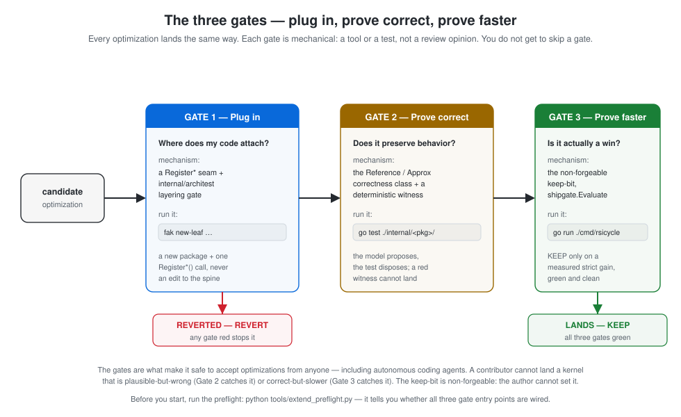

# Level 2 — The registration seam: where does my code attach?

*You are on **Level 2 of 6** of the [kernel-development ladder](README.md).*

> **What this is.** The plug-in rung. Rung 1 said a kernel is a small, whole-op
> function the forward loop calls. This rung answers the question that comes next:
> **where does my code attach?** The answer is one sentence — *a new package plus one
> `Register*()` call, never an edit to the spine* — and the rest of this page is why
> that sentence is load-bearing, what the real seams are called, and how the file tree
> is arranged so two workers can build two ideas at once without colliding. By the end
> you can name the seam your idea attaches to and the directory it lives in.

## Questions this page answers

- Why can't I just edit the spine and add my feature to the core?
- What is a `Register*()` call, and who calls it?
- What are the real seams — what are they actually named?
- What stops two workers from colliding on the same files?
- What is a **lane**, and what does `dos.toml` declare?
- How do I scaffold a new leaf, and how do I know I put it at the right tier?
- What does the layering gate refuse, and why?

## Why can't I just edit the spine?

Because the spine is the one tree **every** worker imports. `internal/abi` is the frozen
ABI — the shared vocabulary of tool calls, verdicts, and refs that every leaf and every
command depends on. If you edit it, you have changed a file that a hundred other
in-flight changes also depend on, and the whole fleet recompiles against your edit. That
is the collision the architecture exists to prevent.

So the design goal is a **stable minimal spine with real extension seams**: open enough
that any future idea attaches as *a new package + one `Register*()` call + (optionally)
one additive envelope field guarded by a Capability*, never an edit to the spine. The
kernel **walks** the registries; it never imports a driver.

## What is a `Register*()` call?

It is a function in `internal/abi/registry.go` that a driver package calls from its own
`init()`. The driver mutates the locked builder state; the registry rebuilds one immutable
snapshot; the kernel reads that snapshot on every syscall. The driver depends only on
`abi` — the arrow points *inward*, never back out.

```
  your package                 the frozen spine                 the kernel
  ------------                 ----------------                 ----------
  internal/myidea/             internal/abi/registry.go         internal/kernel
    func init() {   ──────►      RegisterAdjudicator(rank, me)      │
      abi.RegisterAdjudicator(   └─ appends to reg.adjudicators     │
        rank, myRung{})          └─ rebuildSnapshot()  ──────►   abi.AdjudicatorsFor(call)
    }                                                              │
                                                                   ▼
  the kernel NEVER imports internal/myidea.            your code runs, in rank order,
  It walks the registry and calls your method.         as one link in the fold.
```

The arrow is the whole point: **the kernel never imports your code.** It holds an
interface, walks a slice, and calls a method. Your package can be added or replaced by
one import line; the kernel's source does not change.

## What are the real seams?

There are two registries, by where your optimization lives. The **cross-worker** seams
live in the frozen ABI (`internal/abi`); the **device-compute** seam lives in
`internal/compute`, deliberately outside the ABI because device math is internal to the
model, not a cross-worker contract. The ABI registration kinds, read from
`internal/abi/registry.go`:

| To add… | The call | The driver interface |
|---|---|---|
| a policy / admission rung | `RegisterAdjudicator(rank, impl)` | `Adjudicator` |
| a write-time result gate | `RegisterResultAdmitter(rank, impl)` | `ResultAdmitter` |
| a local fast-path (vDSO) answer | `RegisterFastPath(tier, impl)` | `FastPath` |
| an operation (async submit, spec commit) | `RegisterOp(impl)` | `Op` (panics on opcode clash) |
| a verdict kind | `RegisterVerdictKind(k>1023, name, foldRank, fallback)` | — |
| a refusal reason | `RegisterReason(code, name)` | — |
| a negotiable feature token | `RegisterCapability(c)` | `Capability` |
| a KPI / steward / label tap | `RegisterEmitter(e)` / `RegisterSteward(s)` | `Emitter` / `Steward` |
| a serving engine (local/remote/multi) | `RegisterEngine(id, impl)` | `EngineDriver` |
| the Ref backend (zero-copy) | `RegisterRegionBackend(impl)` | `RegionBackend` |
| the KV-MMU enforcement backend | `RegisterKVBackend(f)` | `KVBackendFactory` |
| an MMU page-out codec | `RegisterPageOutBackend(id, impl)` | `PageOutBackend` |
| a witness type | `RegisterWitnessResolver(id, impl)` | `WitnessResolver` |
| a retractable-effect sink | `RegisterProvisionalSink(s)` | `ProvisionalSink` |

Numbers come from **reserved per-subsystem ranges** — `OpsCore = Range{0, 64}`,
`OpsSpec = Range{64, 96}`, `OpsAsync = Range{96, 128}`, `OpsVendor = Range{1 << 16, 1 << 17}`,
and the same shape for `ExtKey` sidecars, event kinds, and vendor verdicts. `Register*`
panics on a clash, so independently-built leaves cannot collide even when added in
parallel. A verdict kind must be **above** `VerdictReservedMax` (1023); the closed core
set below it is not yours to extend.

The device-compute seam is a sibling: `compute.Register(b Backend)` in
`internal/compute/compute.go`, where `Backend` is one small interface of whole ops —
`MatMul`, `BatchedMatMul`, `RMSNorm`, `RoPE`, `SwiGLU`, `Attention`, `Argmax`, plus
`Upload`/`Read`/`NewKV` for residency. A backend is a new **file** in `internal/compute/`
that self-registers in `init()`. Do not confuse it with `RegisterEngine`, which attaches
an OpenAI-compatible *serving* engine — a different layer.

## What stops two workers from colliding?

**File-tree disjointness.** Each leaf is its own directory, so two ideas added in parallel
by two workers edit **disjoint files** — a property of the tree, not the import graph.

```
  internal/abi/          ← FROZEN spine. EXCLUSIVE lane: an ABI change is the
    registry.go             serial gate every leaf imports. No worker leases it.
  internal/adjudicator/  ← lane "adjudicator"  ─┐
  internal/ctxmmu/       ← lane "ctxmmu"        ├─ pairwise-disjoint trees;
  internal/myidea/       ← lane "myidea"       ─┘  two workers, two lanes, no overlap
  internal/registrations/ ← blank-imports the built-in leaves (one line per idea)
```

A **lane** is the slice of the file tree a piece of work is allowed to touch. A **lease**
is the loan of that lane that stops two workers editing the same files at once. The
arbiter keys concurrency on the lane: two workers wanting the same named lane serialize
even on disjoint sub-trees. So the honest partition is **one lane per leaf**, and that is
what lets the live fleet edit N leaves in parallel.

`dos.toml` declares it. The `[lanes]` table lists the concurrent lanes; `exclusive`
lists the ones that run alone — `exclusive = ["abi", "release", "dos", "global",
"harnesskit"]`, with `abi` there precisely because it is the frozen spine. The
`[lanes.trees]` table maps each lane to its glob, e.g. `myidea = ["internal/myidea/**"]`.
A leaf with **no** declared lane resolves to an empty tree, and an empty tree
conservatively overlaps everything — so an undeclared leaf serializes the whole fleet
behind one worker. `TestEveryLeafDeclaresLane` fails the push that adds such a leaf.

## What is the layering gate?

`internal/architest` is the machine-checked architecture gate. It enforces a five-tier
layering: a leaf may import lower tiers, never higher.

| Tier | Name | Rule |
|---|---|---|
| 0 | `root` | frozen ABI; imports nothing internal |
| 1 | `primitive` | pure libraries; import only root |
| 2 | `foundation-composite` | foundational helpers assembled from primitives |
| 3 | `mechanism` | single-purpose kernel mechanisms and engines |
| 4 | `composer` | workflows composed from mechanisms |
| 5 | `integrator` | top-level wiring, gateways, and registrations |

Every package must declare its tier in the `tier` map in `internal/architest/architest_test.go`
(`TestEveryPackageDeclaresTier` fails otherwise), and `TestNoUpwardImports` fails the build
on an upward import. A violation comes back as a structured reason (`ARCH_LAYER_VIOLATION`)
with the fix. The forced tier choice *is* the review gate: it makes adding a leaf a
conscious layering decision instead of an accident.

This rung is **Gate 1** of the three gates every optimization must clear. The layering gate
is the mechanical half of it — the other half is that your code attaches at a `Register*`
seam instead of an edit to the spine.



## Predict, then run: scaffold a leaf and run the gate

Two commands. Predict each result before you run it.

**Command 1 — the scaffolder's help.** I expect it to exist and print a usage block with
the flags `-tier`, `-register`, `-summary`, `-dry-run`, `-suggest-tier`, `-workspace`.

```bash
go run ./cmd/fak new-leaf --help
```

**What actually happened** (run on this host, 2026-11-18):

```
Usage of new-leaf:
  -dry-run
    	print the planned edits without writing files
  -register
    	add the leaf to the defconfig blank-import list
  -suggest-tier string
    	read-only: print the minimum-correct tier for an existing internal leaf derived from its imports, then exit
  -summary string
    	one-line package summary for doc.go
  -tier string
    	layering tier: primitive, foundation-composite, mechanism, composer, or integrator
  -workspace string
    	workspace root (defaults to current directory)
```

The prediction held. Note the flag order: `fak new-leaf` takes the package name as a
positional argument, so flags must come **before** it. A dry run shows which files a new
leaf would touch:

```bash
go run ./cmd/fak new-leaf --tier mechanism --register --summary "prefix-aware fast cache" --dry-run myfastcache
```

```
"edits": ["internal/myfastcache/doc.go", "internal/myfastcache/myfastcache.go",
  "internal/myfastcache/myfastcache_test.go",
  "internal/architest/architest_test.go (tier table)",
  "internal/registrations/registrations.go (defconfig)", "dos.toml (concurrency lane)"]
```

That list *is* the seam model in one screen: a new directory, a tier declaration, one
blank-import line, and one lane row. Nothing in the spine.

**Command 2 — the layering gate.** I expect the layering checks to pass; the tree is
green today.

```bash
go test ./internal/architest/ -count=1
```

**What actually happened** (run on this host, 2026-11-18): the *package* came back
**FAIL** — but not on the layering gate. The red was
`TestSBOMDriftGateCatchesMutations`, an SBOM-drift check that lives in the same package
and is unrelated to layering. The layering tests themselves pass:

```bash
go test ./internal/architest/ -count=1 -run 'TestNoUpwardImports|TestEveryPackageDeclaresTier|TestEveryLeafDeclaresLane|TestTier'
# ok  	github.com/anthony-chaudhary/fak/internal/architest	9.988s
```

The lesson is worth more than the green: **a package-level red is not necessarily your
gate's red.** Read the failing test's name before you conclude your change broke the
layering. Here the layering contract is green; a sibling gate in the same package is red
for an unrelated reason.

## Worked example: which seam does my idea attach to?

| Idea | The seam | Where it lives |
|---|---|---|
| A new quantization kernel (Q4_K on Metal) | `compute.Register(Backend)` — a new build-tagged file, `Class() = Approx` | `internal/compute/` (new file) |
| A new GPU backend (a Vulkan path) | `compute.Register(Backend)` — same interface, `Tier()` probe picks it | `internal/compute/` (new file) |
| A new cache-eviction policy | `abi.RegisterPageOutBackend(id, impl)` — a swappable MMU codec | `internal/<newleaf>/` (new package) |
| A new admission rung | `abi.RegisterAdjudicator(rank, impl)` — a new link in the fold | `internal/<newleaf>/` (new package) |

The first two are *files* in an existing leaf because device compute is one package with
one registry. The last two are *new packages* because they attach to the cross-worker ABI
and each needs its own lane. In every case: no edit to the spine.

## Common wrong turns

Four things a newcomer tries, and the refusal each one earns.

1. **Edit `internal/abi` directly** — add a field to `ToolCall`, or a `VerdictKind` below
   1023. Refused: `internal/abi` is the frozen spine on the **exclusive** lane, and
   `RegisterVerdictKind` panics with `VerdictKind %d is in the closed core range`. The
   additive path is a new kind *above* `VerdictReservedMax`, or a Capability-guarded field.
2. **Add a `case` to a central switch** in the forward loop or `cmd/fak`. Refused: the
   kernel *walks* the registry and never imports a driver. A new case is an edit to the
   spine's consumer — the exact coupling the seam removes.
3. **Put your package at a tier that imports upward** — a `primitive` importing a
   `mechanism`. Refused: `TestNoUpwardImports` reds with `ARCH_LAYER_VIOLATION`. Declare
   the lowest tier whose role fits; the forced choice is the review gate.
4. **Forget the tier or the lane declaration.** Refused: `TestEveryPackageDeclaresTier`
   fails on an undeclared tier, and `TestEveryLeafDeclaresLane` fails on a leaf with no
   lane — an undeclared leaf resolves to an empty tree that overlaps every live lease.

## Checkpoint

1. Why can't you add your feature by editing `internal/abi`?
2. What does a `Register*()` call do, and who calls it?
3. Name the seam for a new admission rung and the seam for a new GPU backend.
4. What makes two workers' edits disjoint, and what declares it?
5. What does the layering gate refuse, and what is the fix?

### Answers

1. `internal/abi` is the one tree every worker imports, so an edit collides everyone and
   forces a fleet-wide recompile. It is the frozen spine on the exclusive lane.
2. It appends your driver to a registry from your package's `init()`, then rebuilds one
   immutable snapshot. The kernel walks the registry and calls your method; it never
   imports your package.
3. An admission rung: `abi.RegisterAdjudicator(rank, impl)`. A GPU backend:
   `compute.Register(Backend)` — a new file in `internal/compute/`.
4. File-tree disjointness — each leaf is its own directory. `dos.toml` declares it: one
   lane per leaf in `[lanes]`, with the tree glob in `[lanes.trees]`.
5. An upward or cross-tier import (`ARCH_LAYER_VIOLATION`), an undeclared tier, and an
   undeclared lane. The fix is to declare the lowest tier whose role fits and add the lane
   row — `fak new-leaf` does both for you.

## See also

- [Level 1 — What is kernel development?](level-1-what-is-kernel-development.md): the
  whole-op function this rung attaches to the kernel.
- [Level 3 — Prove correct](level-3-prove-correct.md): the gate that decides whether your
  attached kernel is allowed to run.
- [`EXTENDING.md`](../../../EXTENDING.md) — "Gate 1 — Plug in (don't fork)" in full.
- [`ARCHITECTURE.md`](../../../ARCHITECTURE.md) — the frozen ABI, the seam catalog, and
  the scaling contract.
- [The abstraction map](../the-abstraction-map.md) — where the kernel floor sits.

---

*[← Level 1](level-1-what-is-kernel-development.md) · [full ladder](README.md) · next → [Level 3](level-3-prove-correct.md)*
