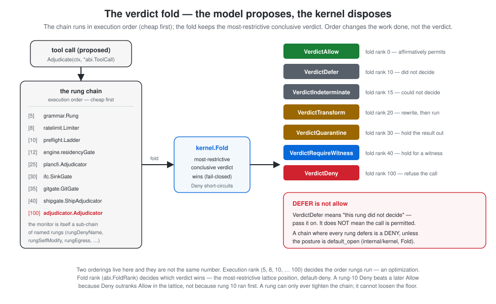

# Level 5 — The adjudicator rung: the other kernel

An adjudicator rung is one admission check in the security kernel's verdict fold. This page applies the same three-gate discipline to that other kernel: the real rung chain, the fold, and how to add a check that refuses a tool after N failures.

*You are on **Level 5 of 6** of the [kernel-development ladder](README.md).*

> **What this is.** Rungs 1–4 taught you to add a *compute* kernel: attach it, prove it
> correct, prove it faster. This rung is about the **other** kernel — the security one.
> It is the same three-gate discipline, pointed at a different question: not "is this
> arithmetic right?" but "may this tool call run at all?" A new admission check is a
> **rung** in a ranked chain, and the chain folds to one verdict. By the end you can name
> the real rungs, read a verdict fold, and add a check that refuses a tool after N
> failures.

## Questions this page answers

- Is the "agent kernel" the same thing as a CUDA kernel?
- What is a **rung**, and what is a **verdict**?
- What does `DEFER` mean — is it the same as "allow"?
- Why are there two different numbers (execution rank and fold rank) on one rung?
- How do I add a new check to the kernel?
- What does a rung *not* get to do on its own?

## Is the agent kernel the same as a CUDA kernel?

No — and the word is doing three jobs in this repo. The
[three-senses table](../what-is-a-cuda-kernel.md) is the disambiguation:

| Sense | What it is | Where it lives | Hardware |
|---|---|---|---|
| **OS-metaphor kernel** | the trust boundary that adjudicates every tool call | `internal/adjudicator`, `internal/kernel` (the verdict fold) | plain CPU, pure Go — **no GPU** |
| **Compute kernel** | the inner-loop math a matmul dispatches to | `matKernel` in `internal/model/kernel.go` | host CPU (Go) |
| **CUDA kernel** | a `__global__` function launched onto the GPU | `internal/compute/cuda_kernels.cu` | the GPU itself |

Rungs 1–4 were about the middle and bottom rows. This rung is the **top row**: the
reference monitor. It borrows the operating-system sense of "kernel" — the code a user
program cannot bypass — and applies it to an LLM agent. The model proposes a tool call;
the kernel disposes ([the tool call is a syscall](../tool-call-is-a-syscall.md),
[policy in the kernel](../policy-in-the-kernel.md)); this page is the *developer's* view.

## What is a rung, and what is a verdict?

A **rung** is one small admission check, registered into a ranked chain. A **verdict** is
what a rung returns. The kernel walks the chain and folds the verdicts into one answer.

A rung is a Go type with one method, `Adjudicate(ctx, *abi.ToolCall) abi.Verdict`, and it
attaches through exactly one seam — the same "register, don't fork" rule as the compute
HAL:

```go
// internal/abi/registry.go — the only way to extend the kernel
func RegisterAdjudicator(rank int, a Adjudicator)   // lower rank runs first
```

The verdict is one of a **closed set** (`internal/abi/types.go`). There are seven kinds,
and the two you must not confuse are `Allow` and `Defer`:

| Verdict kind | Meaning | Fold rank |
|---|---|---|
| `VerdictAllow` | this rung affirmatively permits the call | 0 |
| `VerdictDefer` | **this rung did not decide** — pass it on | 10 |
| `VerdictIndeterminate` | this rung could not decide, and says so | 15 |
| `VerdictTransform` | rewrite the call to a safe form, then run it | 20 |
| `VerdictQuarantine` | hold the result out of context | 30 |
| `VerdictRequireWitness` | hold the call until an independent witness clears it | 40 |
| `VerdictDeny` | refuse the call | 100 |

`DEFER` is the one that trips everyone. It does **not** mean "allow." It means "I have no
opinion; let the next rung decide." A chain where *every* rung defers is not an allow —
it is a deny, unless the posture is `default_open` (`internal/kernel/kernel.go`, `Fold`).

## What does the verdict fold actually do?

`internal/kernel.Fold` walks the rank-sorted chain, keeps the **most restrictive**
conclusive verdict, and returns it. `Defer` is skipped; `Indeterminate` is remembered but
not committed; the highest `abi.FoldRank` wins, ties going to the first rung that reached
it. A `Deny` (rank 100) short-circuits the walk.

```
   tool call  ──►  ┌──────────────────────────────────────────────────────┐
   (proposed)      │  the rung chain, in EXECUTION order (cheap first)    │
                   │                                                      │
                   │   [5]  grammar.Rung ............ DEFER               │
                   │   [8]  ratelimit.Limiter ....... DEFER               │
                   │   [10] preflight.Ladder ........ DEFER               │
                   │   [12] engine.residencyGate .... DEFER               │
                   │   [25] plancfi.Adjudicator ..... DEFER               │
                   │   [30] ifc.SinkGate ............ DEFER               │
                   │   [35] gitgate.GitGate ......... DEFER               │
                   │   [40] shipgate.ShipAdjudicator  DEFER               │
                   │   [100] adjudicator.Adjudicator  DENY  ◄── winner    │
                   └───────────────────────────┬──────────────────────────┘
                                               │  fold: most-restrictive wins
                                               ▼
                        ┌──────────────────────────────────────────┐
                        │  ONE verdict:  ALLOW | DENY | TRANSFORM  │
                        │                QUARANTINE | WITNESS      │
                        └──────────────────────────────────────────┘
```



Two orderings live here and they are **not the same number**:

- **Execution rank** (5, 8, 10, … 100) decides the *order rungs run* — cheap checks
  first, so a cheap deny short-circuits the expensive ones. It is an optimization.
- **Fold rank** (`abi.FoldRank`) decides *which verdict wins* — the most-restrictive
  lattice position, default-deny. A rung-10 `Deny` beats a later `Allow` because `Deny`
  outranks `Allow` in the lattice, **not** because rung 10 ran first.

A rung can also register a **new** verdict kind without a core edit:
`abi.RegisterVerdictKind(k, name, foldRank, fallback)` for any `k > 1023`. `internal/plancfi`
registers `VerdictRequireApproval` (1024) at fold rank 50 — outranking a transform, not a deny.

## The real rungs, in source

Do not take a rung name from a doc; read the `RegisterAdjudicator` call. These are the
ones actually registered (execution rank → package):

| Rank | Rung | Package | Role |
|---|---|---|---|
| 5 | grammar | `internal/grammar` | repair/normalize a malformed call; the cheapest rung |
| 8 | rate-limit | `internal/ratelimit` | throttle call volume |
| 10 | preflight | `internal/preflight` | JSON parse + schema well-formedness |
| 12 | engine residency | `internal/engine` | gate on engine/model residency |
| 25 | plan-CFI | `internal/plancfi` | plan control-flow integrity |
| 30 | IFC sink-gate | `internal/ifc` | refuse a sensitive-sink call when tainted data is in flight |
| 35 | git-gate *(optional)* | `internal/gitgate` | git-operation shape gate; skipped when `FAK_GITGATE=off` |
| 40 | ship-gate | `internal/shipgate` | ship/commit gate |
| 100 | monitor | `internal/adjudicator` | the authoritative capability/policy decision |

That is **8 rungs always, 9 with git-gate on** — exactly what the `--explain` trace below
prints. The monitor is itself a *sub-chain* of named rungs (`rungDenyName`, `rungSelfModify`,
`rungArgPredicate`, `rungEgress`, `rungTransform`, `rungDefaultDeny`, … in
`internal/adjudicator/rungprofile.go`); the whole monitor is one link in the outer chain.

## Predict, then run: read a real verdict fold

The `fak preflight` CLI folds the **entire** registered chain over one call, offline — no
server, no model, no network. (Careful: the CLI is *not* the `internal/preflight` package;
the package is only rung 10. The CLI is the whole fold.)

**Predict first.** The example policy `examples/customer-support-readonly-policy.json` sets
`posture: fail_closed` and names `refund_payment` in its `deny` map with reason
`POLICY_BLOCK`. So I expect the monitor (rank 100) to `DENY`, every cheaper rung to `DEFER`,
and the fold to pick the deny. Run it from the repo root:

```bash
go run ./cmd/fak preflight --policy examples/customer-support-readonly-policy.json \
  --tool refund_payment --args "{}" --explain
```

**What actually happened** (run on this host, 2026-11-18):

```
fak: loaded capability floor from examples/customer-support-readonly-policy.json
tool: refund_payment   args: 2 bytes (sha 44136fa355b3)
verdict: DENY   reason: POLICY_BLOCK   by: monitor   disposition: RETRYABLE
remedy: (none — no sanctioned alternative is known for this call)

decision chain (9 rung(s), most-restrictive wins):
   [0] grammar.Rung               DEFER     by=grammar
   [1] ratelimit.Limiter          DEFER     by=ratelimit
   [2] preflight.Ladder           DEFER     by=preflight
   [3] engine.residencyGate       DEFER     by=engine-residency
   [4] plancfi.Adjudicator        DEFER     by=plancfi
   [5] ifc.SinkGate               DEFER     by=ifc-sink
   [6] gitgate.GitGate            DEFER     by=gitgate
   [7] shipgate.ShipAdjudicator   DEFER     by=shipgate
=> [8] adjudicator.Adjudicator    DENY      POLICY_BLOCK by=monitor   <- winner (rank 100)
```

The prediction held. How to read it: eight rungs `DEFER` (they had no opinion), the monitor
`DENY`s, and the fold picks the deny because `Deny` is the most restrictive verdict in the
lattice. `disposition: RETRYABLE` is a second, orthogonal axis — `VerdictDisposition` maps
the *reason* to a recovery hint (`RETRYABLE`, `WAIT`, `ESCALATE`, `TERMINAL`).

Two more folds worth running, both instant and offline:

```bash
go run ./cmd/fak preflight --tool Bash --args '{"command":"rm -rf /"}'
# -> DENY (POLICY_BLOCK) by=monitor/gotchas: the dangerous-gotcha floor, regardless of posture

go run ./cmd/fak preflight --tool Bash --args '{"command":"rm -f x"}' --explain
# -> verdict: WITNESS by: monitor/reversibility  (fold rank 40)
```

The second is the interesting one: the monitor's *reversibility* rung returns
`VerdictRequireWitness` — not a deny, a **hold**. The call is parked until an
independently-authored witness clears it. That is a rung choosing a *different* verdict
kind, and the fold ranking it at 40 (above transform, below deny).

## Worked example: refuse a tool after N failures

The question: *"I want a rung that refuses calls to a tool after N consecutive failures."*
Walk it through the three gates.

**Which seam?** `abi.RegisterAdjudicator(rank, impl)` — a new rung. Pick a rank that runs
*after* the cheap syntax rungs but *before* the monitor, so a malformed call is caught
first and your rung sees a well-formed one. (The agent tool gates use 20–23 for this.)

**Which verdict?** `VerdictDeny`, with a reason from the **closed vocabulary**
(`internal/abi/reasons.go`) — never free text. A refusal carries a machine-checkable code
(`POLICY_BLOCK`, `RATE_LIMITED`, `SELF_MODIFY`, …), and the disposition is derived from it.

**Which witness?** A deterministic test that drives the rung N+1 times and asserts the
verdict flips on the Nth. This is not hypothetical — the kernel already ships this exact
mechanism, and it is the model to copy.

The in-kernel **circuit breaker** (`internal/adjudicator/circuit_breaker.go`) refuses a
tool after `DefaultCircuitBreakerThreshold = 3` *consecutive identical* refusals. It is
not a separate rung; it is a post-step the monitor runs on its own verdict
(`evaluateCircuitBreaker` in `decide.go`). When the streak hits the threshold it rewrites
the verdict:

```
   turn 1:  Bash{rm -rf /}  ──►  DENY  POLICY_BLOCK     (count = 1)
   turn 2:  Bash{rm -rf /}  ──►  DENY  POLICY_BLOCK     (count = 2)
   turn 3:  Bash{rm -rf /}  ──►  DENY  DOOM_LOOP        (count = 3, tripped)
                                   ▲
                                   └─ ReasonDoomLoop = 1140, name "DOOM_LOOP",
                                      Disposition = "DOOM_LOOP",
                                      Meta["remedy"] = "pivot to a different tool,
                                      adapt arguments, or emit a structured refusal"
```

The counter resets on any *permitted* call, on a *different* tool, on a *different*
reason, or on *adapted arguments* — so it fires on a genuine loop, not on a busy session.
The witness is `TestAdjudicate_CircuitBreakerDoomLoop` in
`internal/adjudicator/circuit_breaker_test.go`; run it:

```bash
go test ./internal/adjudicator/ -run 'TestAdjudicate_CircuitBreakerDoomLoop' -count=1 -v
```

**What actually happened** (run on this host, 2026-11-18): `--- PASS` in 0.01s, with ten
sub-tests green — including `consecutive_identical_refusals_trip_circuit_breaker_at_threshold_K=3`
and `adapted_arguments_reset_counter`. That is the whole pattern: a rung (or a post-step),
a verdict from the closed set, and a deterministic witness that drives it to the edge.

## What a rung does NOT get to do

- **It cannot loosen the floor.** The fold takes the most-restrictive verdict, so adding a
  rung can only ever *tighten* the chain. A rung that returns `Allow` cannot override a
  later `Deny`.
- **It cannot block on its own opinion.** A steward-style rung returns a violation only
  with an independently-authored witness, else it abstains (`internal/steward`).
- **It cannot invent a reason.** The refusal vocabulary is closed; a new reason is
  `abi.RegisterReason(code, name)`, not a string literal.
- **It cannot run out of process.** The decide path never shells out (`TestNoOsExecOnHotPath`).

## Checkpoint

1. What is the difference between a rung's *execution rank* and its *fold rank*?
2. A rung returns `DEFER`. Did it allow the call?
3. Which verdict kind does the monitor's reversibility rung return, and what does it mean?
4. You want to refuse a tool after N failures. Which seam, which verdict, which witness?
5. Name one thing a rung cannot do.

### Answers

1. Execution rank decides the *order rungs run* (cheap first — an optimization); fold rank
   decides *which verdict wins* (the most-restrictive lattice position, default-deny).
2. No. `DEFER` means "this rung did not decide." A chain where every rung defers is a deny
   unless the posture is `default_open`.
3. `VerdictRequireWitness` (fold rank 40) — the call is *held*, not refused, until an
   independently-authored witness clears it.
4. The seam is `abi.RegisterAdjudicator(rank, impl)`; the verdict is `VerdictDeny` with a
   reason from the closed vocabulary; the witness is a deterministic test that drives the
   rung N+1 times and asserts the flip on the Nth (the shipped model is the circuit
   breaker, `DefaultCircuitBreakerThreshold = 3`, `ReasonDoomLoop`).
5. Any one of: loosen the floor; block on its own opinion without a witness; invent a
   reason code; run out of process.

## See also

- [Level 4 — Prove faster](level-4-prove-faster.md): the keep-bit, the gate before this one.
- [Level 6 — The kernel-development frontier](level-6-the-kernel-development-frontier.md):
  what is still open.
- [The tool call is a syscall](../tool-call-is-a-syscall.md) — the mental model this rung
  implements; [policy in the kernel](../policy-in-the-kernel.md) — why the check is in-process.
- [`docs/glossary.md`](../../glossary.md) — the authoritative rank table and the
  execution-rank vs fold-rank distinction.

---

*[← Level 4](level-4-prove-faster.md) · [full ladder](README.md) · next → [Level 6](level-6-the-kernel-development-frontier.md)*
