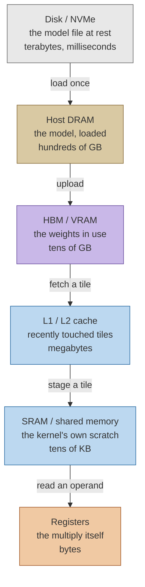

# Level 1 — What is a buffer?

A buffer is a place where numbers wait between the step that produced them and the step that needs them. This page explains the memory hierarchy with no math and no code: why a computer that can think fast still has to wait for its own numbers.

*You are on **Level 1 of 5** of the [fak memory-hierarchy ladder](README.md).*

> **Audience.** You do not need to know what a matrix is, what a GPU is, or how to
> program. If you can picture a desk and a filing cabinet, you can read this page.
> By the end you will be able to explain to someone else why a computer that can
> do billions of sums per second still spends most of its time *waiting*.

> **Short answer.** A **buffer** is a place to put numbers. A computer has several
> of them, stacked from tiny-and-instant to huge-and-slow. The arithmetic can only
> touch numbers that are in the smallest, fastest one. So every calculation is
> really two things: *fetch the numbers*, then *do the sum*. The fetch is almost
> always the expensive half.

## Why does a computer need more than one place to put numbers?

Because there is a trade-off that physics will not let you escape: **the closer a
storage cell is to the thing doing the arithmetic, the faster it can be read — and
the fewer of them you can fit.**

Think about your own desk. You can hold maybe three sheets of paper in your hands.
You can spread a few dozen across the desk. The filing cabinet holds thousands but
you have to stand up and walk to it. The archive in the basement holds everything
you have ever written, and fetching one folder takes a trip downstairs.

You would never work by walking to the basement for every single number you need
to add. You also cannot fit the whole archive on your desk. So you do what every
computer does: **you keep the thing you are working on close, and you keep
everything else further away, and you move things between the layers as you need
them.**

That is the entire memory hierarchy. Everything else is detail.

## What is a buffer, exactly?

A **buffer** is just a named region of one of those places, holding a run of
numbers, that some part of the program has agreed to use for a particular purpose.

That is deliberately unglamorous. A buffer is not a clever data structure. It is
"here is a block of memory, here is what we are putting in it, here is who is
allowed to read it." In this repository you will meet buffers with names like
*weights*, *activations*, *KV cache*, *scratchpad*, and *staging ring* — and every
one of them is that same idea: a labelled block of numbers in one of the tiers.

The reason the word matters is that **naming the buffer names the tier**, and the
tier tells you the cost. When a page in this ladder says "the activations live in
device memory," it is telling you both where the numbers are and roughly how
expensive it was to put them there.

## The one table that explains every slow program

Here is the whole hierarchy. The numbers are deliberately vague — the *ratios*
are the point, and the ratios are enormous.

| Tier | How much fits | How long a fetch takes | Analogy |
|---|---|---|---|
| **Registers** | a handful of numbers | effectively zero | the numbers in your head |
| **SRAM / shared memory** | a few thousand numbers | a few clock ticks | the sheet in your hand |
| **L1 / L2 cache** | a few million numbers | tens of ticks | the desk |
| **HBM / VRAM** | billions of numbers | hundreds of ticks | the filing cabinet |
| **Host DRAM** | tens of billions | thousands of ticks | the shelf in the next room |
| **NVMe / disk** | trillions | millions of ticks | the basement archive |

Read the last column again. Going from the sheet in your hand to the basement
archive is not "a bit slower." It is roughly **a million times slower**. That gap
is why a program can be doing the *same arithmetic* as another program and be a
thousand times slower: it is not thinking harder, it is walking to the basement
more often.

> **The rule to remember.** Arithmetic is nearly free. *Moving numbers* is what
> you pay for. A fast program is one that arranges to move as few numbers as
> possible, from as close as possible.

## Where does a language model keep its numbers?

A language model is, physically, a very large pile of numbers — the **weights** —
plus a much smaller working set that changes as it runs. Here is the picture, and
it is the picture the rest of this ladder zooms into:



Every arrow in that diagram is a *move*, and every move costs time. The
interesting engineering question is never "how do we do the multiply faster" — it
is "how do we make fewer, bigger, better-timed moves along those arrows."

## Why can't we just put everything in the fast tier?

Two reasons, and both are worth saying out loud because they are the reason this
ladder exists.

**First, it does not fit.** The fast tiers are physically small. A shared-memory
scratchpad is measured in tens of kilobytes; a model's weights are measured in
tens of gigabytes. That is a factor of about a million. You cannot put the filing
cabinet on your desk.

**Second, even if it fit, you would not want it to.** The fast tiers are fast
*because* they are small and close. Making them bigger makes them slower. There is
no configuration of the machine where everything is instant.

So the hierarchy is not a design flaw to be engineered away. It is the terrain.
The craft is navigating it.

## A worked example you can do in your head

Suppose you need to add up 1,000 numbers, and they are all sitting in the basement
archive. Two strategies:

- **Strategy A — fetch each one as you need it.** 1,000 trips downstairs. If each
  trip takes a minute, that is 1,000 minutes. The adding itself takes a second.
- **Strategy B — carry up the whole box once.** One trip, then 1,000 additions at
  your desk. Total: about a minute.

Same arithmetic. Same answer. **A thousand-fold difference in time**, entirely
from *when* you moved the numbers.

This is not a toy. It is exactly the difference between a kernel that reads its
weights from device memory once per tile and one that re-reads them per element.
Level 3 shows you the real code where this decision is made, and Level 4 shows you
how to measure which one you got.

## What is the difference between "how much" and "how fast"?

These get conflated constantly, and separating them is the single most useful
thing on this page.

- **Capacity** is *how much fits*. It answers "can I even run this model on this
  machine?" It is a yes/no question with a cliff: it fits, or it does not.
- **Bandwidth** is *how fast numbers move*. It answers "how quickly can I feed the
  arithmetic?" It is a rate, and it is almost always the thing that limits you.

A machine can have plenty of capacity and terrible bandwidth, or the reverse. When
someone says "this model is too big for my machine," they mean capacity. When
someone says "this model is slow," they almost always mean bandwidth.

fak keeps these two ideas in separate, explicitly-named places in the code, which
is why Level 4 can point at a single type for each. For now, just hold the
distinction: **fits** and **fast** are different questions.

## Try it

You do not need to run anything to finish Level 1. But if you want to see the
hierarchy named in real code, this prints the vocabulary the rest of the ladder
uses — the list of memory *classes* the engine distinguishes:

```sh
sed -n '61,75p' internal/compute/capacity.go
```

You will see names like `weights`, `kv_cache`, `offload`, and `scratchpad`. Each
one is a buffer, in a tier, with a cost. That is the whole page, in Go.

## See also

- [The full ladder](README.md) — the index, the one-sentence answer, and the
  hierarchy table in one place.
- [Level 2 — The forward pass as a sequence of buffer moves](level-2-the-forward-pass-as-buffer-moves.md)
  — the same story, but following one real token through the real code.
- [The fak/DOS glossary](../glossary.md) — one-line definitions if a word here was
  unfamiliar.
- [The abstraction map](../the-abstraction-map.md) — where all of this sits in the
  full stack, from your terminal to the silicon.
- [The hierarchy as one figure](../../../visuals/86-buffer-hierarchy-ladder.mmd) — the
  six tiers on one page, rendered standalone (`.svg` / `.png` beside it) for slides and
  handouts.

---

*[full ladder](README.md) · next → [Level 2 — The forward pass as a sequence of buffer moves](level-2-the-forward-pass-as-buffer-moves.md)*
