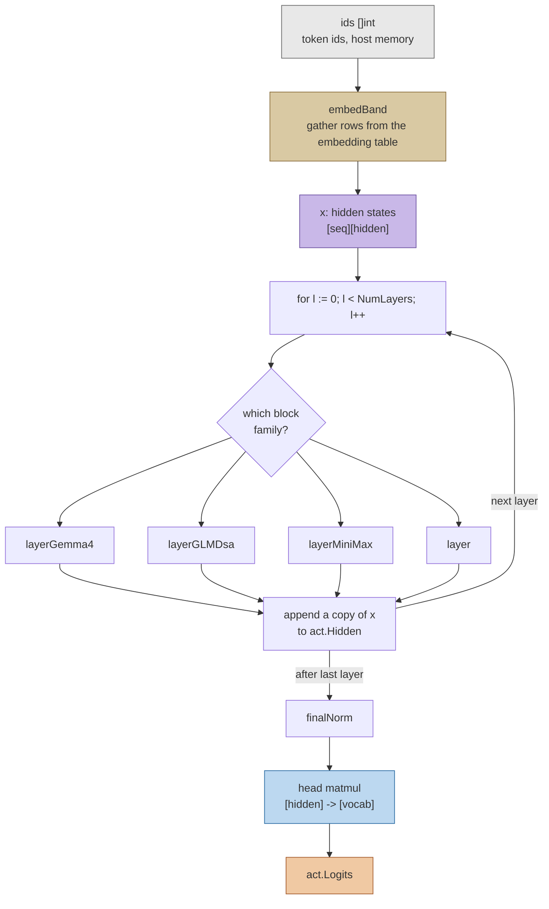

# Level 2 — The forward pass as a sequence of buffer moves

*You are on **Level 2 of 5** of the [fak memory-hierarchy ladder](README.md).*

> **Audience.** You can read Go — functions, slices, structs, a `for` loop — and you
> have finished Level 1. You do not need to know what attention is. By the end you
> will be able to open `internal/model/forward.go`, read the forward pass top to
> bottom, and say for each line *which buffer it touches and which tier that buffer
> lives in*.

> **Short answer.** The forward pass is a loop over layers. Each iteration takes a
> buffer of hidden states, reads a layer's weights, and writes a new buffer of
> hidden states. The weights are the big, mostly-static buffer; the hidden states
> are the small, constantly-rewritten one. Everything the engine does about memory
> is in service of that one asymmetry.

## What does the forward pass actually take in and give back?

It takes **token ids** — integers — and gives back **logits**: one score per
vocabulary entry, per position. That is the whole contract.

In this repository the return value is a struct, and reading its fields is the
fastest way to see the buffers:

```go
type Activations struct {
	Seq    int
	Hidden [][]float32 // [NumLayers+1] each len seq*hidden
	Logits [][]float32 // [seq] each len vocab
}
```

That is `internal/model/forward.go:427`. Two things are worth noticing, and both
are memory facts rather than math facts.

**`Hidden` has `NumLayers+1` entries, not `NumLayers`.** The engine keeps the
hidden state *at every layer boundary*, not just the last one. That is a
deliberate memory-for-information trade: it costs `NumLayers+1` buffers instead of
one, and it buys the ability to inspect, debug, and (in other configurations)
resume from any layer. The comment on the next line spells the shape out —
`internal/model/forward.go:429`.

**`Logits` is `[seq]` slices each of length `vocab`.** For a real vocabulary that
is a large buffer, and it is produced *once*, at the end. It is not per-layer. So
the memory profile of a forward pass is: a long sequence of small-ish hidden
buffers, then one big logits buffer at the very end.

## Where does the first buffer come from?

From a **gather**. The token ids index into an embedding table, and the result is
the first hidden state:

```go
func (m *Model) embedBand(ids []int) [][]float32 {
```

That is `internal/model/partition.go:91`. A gather is the cheapest possible
memory operation in terms of arithmetic — it does no arithmetic at all — and one
of the most expensive in terms of *movement*, because it touches a scattered set
of rows in a large table. If the table is in device memory and the ids are on the
host, you have just paid for a transfer. This is exactly the kind of thing Level 4
teaches you to measure.

## What is the main loop, in one function?

Here it is:

```go
func (m *Model) Forward(ids []int) *Activations {
```

`internal/model/forward.go:483`. Its doc comment is unusually honest about scope,
and worth quoting because it tells you which rung of the *engine's* own
development you are looking at: this entry point runs a full prefill over token
ids and returns every hidden state plus per-position logits, with **no KV cache** —
"this rung proves the math." The KV cache is a later rung, and it is a pure memory
optimization: it changes *which buffers exist*, not what the arithmetic computes.

`Forward` ends by handing the embedded rows to the real worker:

```go
func (m *Model) forwardHiddenRows(x [][]float32) *Activations {
```

`internal/model/forward.go:508`. This is the loop. In outline:



The dispatch in the middle is the interesting part for a memory reader. The loop
does not call one function; it picks a *block family* per layer. Different model
families have different block internals, and therefore different buffer
requirements — a mixture-of-experts block touches a different set of weight
buffers than a dense block does. Level 5 is where that difference becomes the
whole story.

## What does one layer do to the buffer?

```go
func (m *Model) layer(l int, x [][]float32, rp rope) {
```

`internal/model/forward.go:572`, with the doc comment "layer applies one decoder
block to x **in place**."

*In place* is the load-bearing phrase. The layer does not allocate a new hidden
buffer and return it; it rewrites the one it was given. That is a memory decision
with a real consequence: it means the loop's working set does not grow with depth.
If each layer allocated a fresh buffer, a 60-layer model would hold 60 live hidden
buffers at once. In place, it holds one (plus the copies appended to `act.Hidden`
for inspection).

This is the first place in the ladder where you can see the general principle
stated as code: **the engine is willing to spend arithmetic to avoid spending
memory.** Rewriting in place is not free — it constrains the order of operations —
but it keeps the working set flat.

## Where do the weights live, and why does that matter more than anything else?

The weights are the big buffer. For a real model they are tens of gigabytes, and
they are read *every single layer, every single token*. The hidden states, by
contrast, are kilobytes to megabytes and are rewritten constantly.

That asymmetry is the whole game:

| Buffer | Size | Lifetime | Read how often |
|---|---|---|---|
| **Weights** | tens of GB | the whole session | every layer, every token |
| **Hidden states** | KB–MB | one layer | once, then rewritten |
| **Logits** | MB | one step | once per step |
| **KV cache** | grows with context | the whole session | every decode step |

A buffer that is huge *and* re-read constantly is the one that determines your
bandwidth bill. That is why Level 4 exists, and why the answer to "why is
generation slow?" is almost always "because we re-read the weights."

## What is the last thing that happens?

Two steps, and they are the only place the vocabulary size enters:

```go
func (m *Model) logitsFromHidden(x []float32) []float32 {
```

`internal/model/forward.go:559`. It normalizes the final hidden state, then does
one matrix multiply against the **head** — the weight matrix that maps a hidden
vector of size `hidden` to a score vector of size `vocab`. Then it applies a
scaling factor in place.

The head is a weight buffer like any other, and for a large vocabulary it is a
substantial one. It is read once per step. In a decode loop that is once per
token, which is why "the head matmul" shows up in profiles of long generations
even though it is a single operation.

## What about splitting the model across devices?

There is a second entry point that takes a layer *range*:

```go
func (m *Model) ForwardBand(x [][]float32, lo, hi int, isLast bool) ([][]float32, [][]float32, error) {
```

`internal/model/partition.go:122`. It runs layers `lo` through `hi` and returns
both the hidden states and the logits (the latter only when `isLast`).

This is the memory-hierarchy story at a coarser grain. If the weights do not fit
in one device's memory, you split the *layer range* across devices, and now the
hidden state has to be **moved between devices** at every band boundary. You have
traded a capacity problem for a bandwidth problem — which is often the right
trade, and is exactly the kind of decision Level 4 and Level 5 are about.

## Try it

Read the real loop, in order, from the repository root:

```sh
sed -n '483,520p' internal/model/forward.go
```

Then find every place the loop appends to `act.Hidden` and ask yourself: *how many
live buffers does this hold at once, and could it hold fewer?* That question is
the entire discipline of this ladder, and you can now ask it about real code.

## See also

- [Level 1 — What is a buffer?](level-1-what-is-a-buffer.md) — the tier table and
  the capacity-vs-bandwidth distinction this page assumes.
- [Level 3 — SRAM and the kernel's own scratch](level-3-sram-and-the-kernels-own-scratch.md)
  — what happens *inside* the matmuls this page calls.
- [The caching ladder](../caching/README.md) — the KV cache this page mentions but
  does not open; Level 4 of that ladder is the deep version.
- [The abstraction map](../the-abstraction-map.md) — where `Forward` sits between
  the HTTP request and the silicon.
- [The fak/DOS glossary](../glossary.md) — one-line definitions of *prefill*,
  *decode*, *logits*, and the rest.

---

*[← Level 1 — What is a buffer?](level-1-what-is-a-buffer.md) · [full ladder](README.md) · next → [Level 3 — SRAM and the kernel's own scratch](level-3-sram-and-the-kernels-own-scratch.md)*
