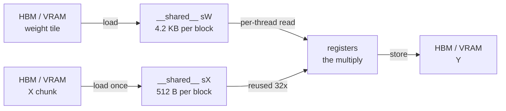
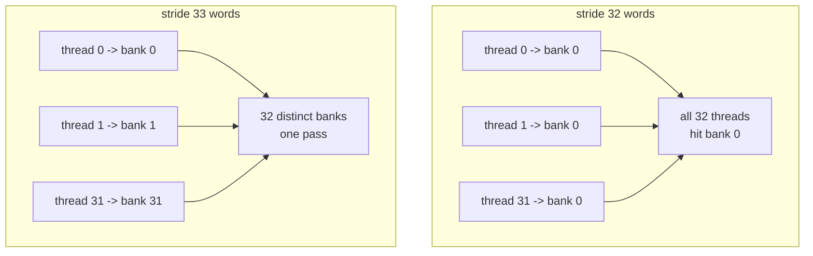

# SRAM and the kernel's own scratch

*You are on **Level 3 of 5** of the [fak memory-hierarchy ladder](README.md).*

> **Audience.** A working engineer who reads C/CUDA and Go and wants the real code.
> By the end you will be able to read a kernel's `__shared__` declarations, compute
> its on-chip footprint by hand, explain why the array sizes are compile-time
> constants, spot the `+1` padding that kills a bank conflict, and find the same
> idea — a reused scratch buffer — in the Go CPU reference backend.

> **Short answer.** A compute unit can only multiply numbers that are already in its
> registers, and re-reading a byte from HBM is the expensive part. So a kernel loads
> a small tile into memory it *owns* — on-chip SRAM declared as `__shared__` — and
> re-reads it many times from there. That memory is tiny and its size is a hard,
> declared number, so kernels are written as tiles that fit it. Everything else in
> this rung is a consequence of that one constraint.

## Why does a kernel need its own scratchpad at all?

Because the arithmetic is cheap and the fetch is not. A thread block that reads a
byte from HBM once and reuses it thirty times from on-chip SRAM has turned thirty
expensive fetches into one. The scratchpad is how you buy that reuse.

The mechanism is `__shared__`: an array declared at the top of the kernel, allocated
once per block, visible to every thread in the block, and freed when the block ends.
It lives on the same die as the arithmetic, so a read from it costs a fraction of a
read from HBM.

The worked example is the routed-expert GEMV. Each block owns `REX_ROWS` rows of
weights (`internal/compute/routed_expert_gemv.cu:23`) and `REX_THREADS` threads
(`internal/compute/routed_expert_gemv.cu:24`). The input chunk `sX` is loaded once
and read by all 32 rows — a reuse factor of 32 that you can read straight off the
constants. The weights themselves are used once each (it is a matrix-*vector*, not a
matrix-matrix), so the tile that pays to be cached is the *input*, not the weight.



## What exactly is `__shared__`, and how big can it be?

It is a statically-sized array whose storage the compiler places in the SM's on-chip
SRAM, one copy per block. You can compute its size by hand from the declarations.

The mechanism: the compiler adds every `__shared__` array to the kernel's resource
footprint. The block scheduler will only place a block on an SM if that SM has room
for the whole footprint, so the footprint is a hard admission number, not a hint.

The worked example is the GEMV's three arrays:

- `sW` is `REX_ROWS * REX_STRIDE_WORDS` = 32 × 33 = 1056 `uint32_t` = **4224 bytes**
  (`internal/compute/routed_expert_gemv.cu:109`).
- `sX` is `REX_FP8_CHUNK_K` = 128 floats = **512 bytes**
  (`internal/compute/routed_expert_gemv.cu:110`).
- `sS` is `REX_FP8_CHUNK_K / 32` = 4 floats = **16 bytes**
  (`internal/compute/routed_expert_gemv.cu:111`).

Total: 4224 + 512 + 16 = **4752 bytes**, about 4.6 KB per block. That is the entire
scratchpad for a kernel that streams a whole expert's weights.

## Why is the array size a `#define` and not a runtime number?

Because the compiler has to know the footprint *before* the kernel runs, to schedule
blocks and to lay the array out in SRAM. A runtime-sized static array would make the
footprint unknowable at compile time.

The mechanism: `#define REX_ROWS 32` and `#define REX_THREADS 256` are compile-time
constants, so `REX_ROWS * REX_STRIDE_WORDS` folds to a literal. The kernel signature
then carries `__launch_bounds__(REX_THREADS)`
(`internal/compute/routed_expert_gemv.cu:106`), which tells the compiler the block
size it must budget for.

The worked example is a *bigger* tile in the same repo. The V4.1 indexer declares
`key_tile[128 * 65]` (`internal/compute/cuda_v41_indexer.cu:29`) — 8320 floats =
**33,280 bytes**, about 32.5 KB — plus `query[128]`
(`internal/compute/cuda_v41_indexer.cu:30`) = 512 bytes. That is roughly seven times
the GEMV's footprint, so far fewer of these blocks fit on one SM. Same language, same
`__shared__`, very different admission math.

## What is the `+1` in `REX_STRIDE_WORDS` actually buying?

It buys a conflict-free read. Shared memory is split into 32 banks of 4 bytes each; if
the 32 threads of a warp read addresses that land in the same bank, the hardware
serializes them.

The mechanism is in the comment on the declaration itself: `REX_STRIDE_WORDS` is
`REX_TILE_WORDS + 1`, and the `+1` is there so "row-per-thread smem reads are
conflict-free" (`internal/compute/routed_expert_gemv.cu:27`).

The worked example is arithmetic you can redo. A thread `t` reading column `c` of row
`t` touches word `t * stride + c`, which lands in bank `(t * stride + c) mod 32`.

- With stride **32**: bank = `(t*32 + c) mod 32` = `c mod 32` — the same bank for all
  32 threads, a 32-way conflict.
- With stride **33**: bank = `(t*33 + c) mod 32` = `(t + c) mod 32` — all 32 distinct,
  one pass.



## What does `__launch_bounds__` have to do with memory?

It is the knob that ties thread count to the register and SRAM budget. By declaring
the maximum threads per block, you let the compiler cap register use so that the
occupancy you want is actually achievable.

The mechanism: `__launch_bounds__(REX_THREADS)` on the GEMV
(`internal/compute/routed_expert_gemv.cu:106`) and `__launch_bounds__(MAE_THREADS)` on
the MoE align kernel (`internal/compute/moe_align_sort.cu:71`) both pin the block size
at compile time. The compiler then knows how many registers it may spend per thread
without making the block unplaceable.

The worked example is illustrative, not measured. Suppose a datacenter GPU offers 2048
thread slots and 228 KB of SRAM per SM. With 256 threads and 4752 bytes per block:

- thread limit: 2048 / 256 = **8 blocks**
- SRAM limit: 228 × 1024 / 4752 ≈ **49 blocks**

Threads bind, so 8 blocks × 256 = 2048 threads — full occupancy. Change the tile to
the indexer's 33 KB and the SRAM limit drops to about 7 blocks, so SRAM starts to
bind. The point is that the tile size and the block size are the same decision.

## When is `extern __shared__` the right choice?

When the tile size depends on a runtime shape — sequence length, head dimension, split
count — so you cannot bake it into a `#define`. Then you declare a dynamically-sized
array and carve it up yourself.

The mechanism: `extern __shared__ float smem[];` is a single untyped block whose byte
count is passed at launch. The kernel then slices it with pointer arithmetic, so one
allocation serves several logical tiles.

The worked example is the shared-attention kernel. It declares
`extern __shared__ float smem[];` (`internal/compute/cuda_v41_shared_attention.cu:44`)
and then carves it into `sq`, `skv`, `sacc`, and `ss` by advancing a pointer. Alongside
it sit three tiny *static* arrays — `s_run[8], s_sum[8], s_alpha[8]`
(`internal/compute/cuda_v41_shared_attention.cu:49`) — 96 bytes total, one slot per
warp, for the running softmax state. The tree-attention kernel does the same carve
(`internal/compute/tree_attention.cu:35`). The rule of thumb: static `__shared__` for
fixed-size state, `extern __shared__` for shape-dependent tiles.

## What is `__ldg` and the L2 promotion hint for?

They are the two ways to tell the hardware "this data is read-only, keep it close."
`__ldg` routes a load through the read-only data path; an L2 promotion hint asks the
hardware to retain a tile in L2.

The mechanism: `__ldg(ptr)` is a load that promises the kernel will not write through
that pointer, so the hardware may serve it from the read-only cache. The L2 promotion
hint is set on a tensor-map descriptor, not on a load.

The worked example: the EPLB map kernel reads its routing table with
`const int32_t expert_id = __ldg(topk_ids + off);`
(`internal/compute/eplb_map_record.cu:54`) — the ids are never written, so the
read-only path is safe. The DeepGEMM WKV kernel sets
`CU_TENSOR_MAP_L2_PROMOTION_L2_256B` on its `cuTensorMapEncodeTiled(...)` call
(`internal/compute/cuda_deepgemm_wkv.cu:31`), asking the hardware to promote 256-byte
sectors of the tile into L2. Both are the same idea one tier up: the tile you re-read
should live in memory the hardware manages for you.

## What is the Go-side equivalent of a scratchpad?

The CPU reference backend has no `__shared__`, but it has the identical idea: a
fixed-size scratch buffer, pooled and reused, so the hot loop never allocates.

The mechanism is a `sync.Pool` of a fixed-size array. The row-dot takes one out,
uses it as the dequantization panel, and puts it back.

The worked example: `scratch := cpuRefScratchPool.Get().(*[q4kSuper]float32)`
(`internal/compute/cpuref.go:206`). `q4kSuper` is 256, so the panel is 256 floats =
**1024 bytes** — one super-block of dequantized weights, the CPU analogue of a
`__shared__` tile. At the other extreme, `argmaxF32`
(`internal/compute/cpuref.go:661`) needs no scratch at all: it is a single running
maximum held in two registers, the smallest possible footprint.

The accounting side lives in the capacity model. `MemoryClass`
(`internal/compute/capacity.go:61`) names the tiers, and `MemoryScratchpad`
(`internal/compute/capacity.go:69`) is the scratchpad row. A `MemoryDemand`
(`internal/compute/capacity.go:87`) is one classed claim on a device, and a
`MemoryPlan` (`internal/compute/capacity.go:100`) is several simultaneous claims —
weights plus expected KV plus scratch — checked before anything is allocated. That is
the same "does the tile fit?" question the block scheduler asks, lifted to the type
level.

## Try it

Run these from the repository root. Each prints the exact lines this rung cites.

```sh
sed -n '23,27p' internal/compute/routed_expert_gemv.cu   # the tile constants and the +1
sed -n '106,111p' internal/compute/routed_expert_gemv.cu # the kernel and its __shared__ arrays
sed -n '29,30p' internal/compute/cuda_v41_indexer.cu     # a much bigger static tile
sed -n '44,49p' internal/compute/cuda_v41_shared_attention.cu # extern smem, carved by hand
sed -n '54p' internal/compute/eplb_map_record.cu         # the __ldg read-only load
sed -n '206,207p' internal/compute/cpuref.go             # the Go-side pooled scratch
```

Then redo the footprint arithmetic yourself: 32 × 33 × 4 + 128 × 4 + 4 × 4 = 4752
bytes. If your number disagrees with the declarations, one of us is wrong.

## See also

- [What is a CUDA kernel?](../what-is-a-cuda-kernel.md) — "kernel" means three
  different things in this repo; read this if that trips you.
- [Hardware limits and capacity](../hardware-limits-and-capacity.md) — the capacity
  model behind `MemoryClass` and `MemoryPlan`.
- [Hardware portability](../hardware-portability.md) — the shape assumptions the
  compute HAL lifts, which is why the same forward loop runs on a CPU or a GPU.
- [The caching ladder](../caching/README.md) — the sibling five-rung ladder: caching
  is *what* to keep close, this ladder is *where* close is.
- [The memory-bandwidth field guide](../../benchmarks/MEMORY-BANDWIDTH-FIELD-GUIDE.md)
  — how to tell a measured ceiling from a marketing one, which Level 4 leans on.
- [One weight tile's life inside a thread block](../../../visuals/87-sram-tile-lifecycle.mmd)
  — this rung's central picture, rendered standalone (`.svg` / `.png` beside it).

---

*[← Level 2 — The forward pass as a sequence of buffer moves](level-2-the-forward-pass-as-buffer-moves.md) · [full ladder](README.md) · next → [Level 4 — HBM, VRAM, and the roofline](level-4-hbm-vram-and-the-roofline.md)*
