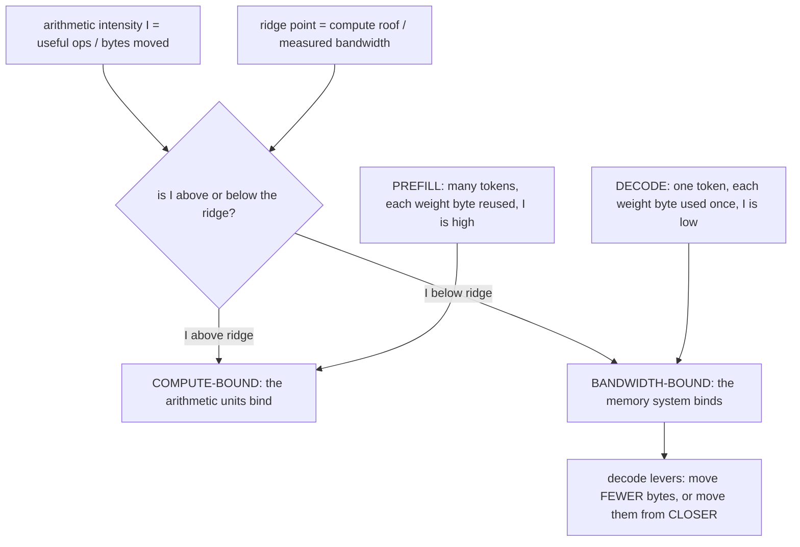
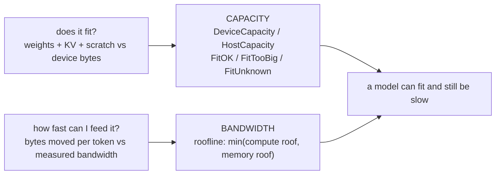
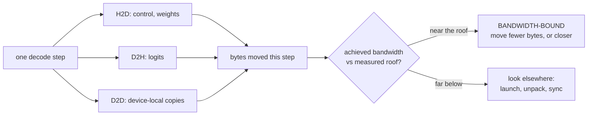

# Level 4 — HBM, VRAM, and the roofline

*You are on **Level 4 of 5** of the [fak memory-hierarchy ladder](README.md).*

> **Audience.** A performance engineer who tunes serving and has finished Levels 1–3.
> By the end you will be able to look at a slow decode step and say *which* resource
> is the binding constraint — compute or memory bandwidth — and name the one or two
> levers that can actually move it, instead of guessing.

> **Short answer.** At decode time the arithmetic is trivial and the *bytes* are the
> cost: one token reads the active weights once and does almost nothing with each
> byte, so the memory system, not the arithmetic units, is the constraint. Prefill is
> the opposite — many tokens reuse each weight byte, so the arithmetic units bind.
> The roofline model tells you which side of that line an operation is on, and the
> only decode levers that matter are "move fewer bytes" and "move them from somewhere
> closer".

## Why is generating one token so much slower than reading a whole prompt?

Because prefill reads many tokens at once and reuses each weight byte across all of
them, while decode reads one token at a time and uses each weight byte exactly once.
The same weight matrix, the same multiply — but prefill gets hundreds of multiplies
per byte fetched and decode gets one.

The mechanism is the shape of the buffer the forward pass is handed. `Forward` takes
token ids and materializes one hidden row per position (`internal/model/forward.go:483`),
then `forwardHiddenRows` runs the decoder stack over those rows
(`internal/model/forward.go:508`), and each `layer` applies attention and MLP to the
whole row set (`internal/model/forward.go:572`). In prefill that row set is the whole
prompt; in decode it is a single row. The weight matrices are the same size either
way, so the *bytes fetched* are roughly constant per launch while the *arithmetic*
scales with the number of rows.

**Worked example (illustrative).** Take one weight matrix of `M` rows by `K` columns,
applied to `B` token-vectors. The multiply-accumulates are `M·K·B`; counting a MAC as
two operations, that is `2·M·K·B` operations. The weight bytes streamed are `M·K·w`,
where `w` is bytes per weight. So the arithmetic intensity is

```text
I = 2·M·K·B / (M·K·w) = 2B / w        [op/byte]
```

For 2-byte weights (`w = 2`), `I = B`. Decode is `B = 1`, so `I = 1` op/byte. A
512-token prefill is `B = 512`, so `I = 512` op/byte. Same matrix, 512× the intensity.
That single ratio is the whole difference between the two phases.

Citation: the field guide defines intensity as useful operations over bytes moved
(`docs/benchmarks/MEMORY-BANDWIDTH-FIELD-GUIDE.md:30`), and the profiler reports
per-op MACs, streamed weight bytes, arithmetic intensity, achieved GB/s, and a verdict
(`docs/benchmarks/MEMORY-BANDWIDTH-FIELD-GUIDE.md:82`).

## What is arithmetic intensity, and where is the ridge point?

Arithmetic intensity is *operations per byte moved*. The ridge point is the intensity
at which a device stops being memory-limited and starts being compute-limited. Below
the ridge you are waiting on bytes; above it you are waiting on arithmetic.

The mechanism is the roofline model. It bounds the attainable arithmetic rate by the
smaller of two roofs: the compute roof (peak useful operations per second) and the
memory roof (measured bandwidth times intensity). The ridge point is where the two
roofs cross — compute roof divided by measured bandwidth
(`docs/benchmarks/MEMORY-BANDWIDTH-FIELD-GUIDE.md:27`,
`docs/benchmarks/MEMORY-BANDWIDTH-FIELD-GUIDE.md:34`). The word *measured* is doing
real work there: the field guide insists you use measured sustainable bandwidth for
the relevant access pattern, not a vendor peak.

**Worked example (illustrative).** Suppose a device with a compute roof of 100
TFLOP/s and a measured bandwidth of 1 TB/s. The ridge point is `100e12 / 1e12 = 100`
op/byte. Decode at `I = 1` sits far below the ridge — bandwidth-bound. Prefill at
`I = 512` sits above it — compute-bound. The crossover is where `2B/w = 100`, i.e.
`B = 100·2/2 = 100` tokens: below a batch of about 100 this device is memory-bound,
above it compute-bound. Every number here is round and chosen so you can redo it by
hand; it is a worked example, not a measurement of any real part.



## Does it fit, or can I feed it? Capacity versus bandwidth

These are two different questions and conflating them is the most common tuning
mistake. **Capacity** asks whether the weights, the KV cache, and the scratch fit in
the device's bytes at all. **Bandwidth** asks how fast you can feed the arithmetic
once they do. A model can fit comfortably and still be slow; a model can be fast and
still not fit. Capacity explains whether an envelope can *run*; it does not prove
throughput.

The mechanism is a typed vocabulary for the capacity half. A backend that can report
its own finite memory implements `DeviceCapacity` (`internal/compute/capacity.go:701`),
and host-scoped pools have an optional companion `HostCapacity`
(`internal/compute/capacity.go:718`). A demand is classed — weights, KV cache, DDR
cache, offload, scratchpad, activation, signal buffer (`internal/compute/capacity.go:61`)
— and a `MemoryDemand` carries one classed byte count (`internal/compute/capacity.go:87`)
while a `MemoryPlan` is a list of them (`internal/compute/capacity.go:100`). The fit
check returns a typed verdict, and the crucial one is `FitUnknown`
(`internal/compute/capacity.go:733`): a backend that cannot probe its ceiling reports
"unknown" and the caller proceeds rather than refusing. When the total is known but
the free bytes are not, the sentinel `FreeUnknown` makes the check fall back to the
whole device as the budget rather than guessing (`internal/compute/capacity.go:44`).
This is the eighth assumption the HAL lifts — the first seven describe what a device
*looks* like, this one describes the one thing every accelerator runs out of
(`internal/compute/capacity.go:9`, `internal/compute/compute.go:311`).

**Worked example (illustrative).** KV bytes grow with sequence length, and that is
where capacity bites. For a config with 8 KV heads and head dim 128 at 2 bytes per
element, one row is `8·128·2 = 2048` bytes; a K row plus a V row is 4096 bytes per
token per layer; across 32 layers that is 128 KiB per token; at 8192 tokens, 1 GiB.
The default precision tier actually keeps three f32 rows rather than two, so the real
figure is larger — the point is the shape, and `EstimateKVStoreBytes` is the function
that computes it from the config and the token count
(`internal/compute/capacity.go:136`). Capacity is a *does it fit* answer; the roofline
is a *how fast* answer, and you need both.



## Why does quantization help twice — and why is the speedup not proportional?

Quantization helps twice because it shrinks the same bytes in two places at once: the
bytes that must be *resident* (capacity) and the bytes that must be *fetched per
token* (bandwidth). It does not guarantee a proportional speedup, because the cheaper
format adds its own costs — dequantization arithmetic, scale and metadata bytes,
alignment, occupancy, launch overhead, and a quality floor you are not allowed to
cross.

The mechanism is that both halves of the roofline move. Fewer resident bytes raises
the ceiling on what fits; fewer fetched bytes lowers the memory roof's denominator, so
the bandwidth-only token rate rises. But the dequantization work raises the operation
count, which lowers the *compute* roof for that path, and the metadata is real traffic
the profiler counts. The field guide states this directly: quantization reduces
resident capacity and bytes fetched per token, and does **not** guarantee proportional
speedup, because dequantization, metadata, alignment, cache behavior, kernel
occupancy, launch overhead, synchronization, and quality constraints still count. The
profiler's job is to report the *streamed* bytes and a verdict against measured
bandwidth, not the nominal format width
(`docs/benchmarks/MEMORY-BANDWIDTH-FIELD-GUIDE.md:82`).

**Worked example (illustrative).** A dense model with 8 GB of 2-byte weights, on a
device with a measured 1 TB/s. The bandwidth-only ceiling is `1e12 / 8e9 = 125`
tokens/s. Move the same weights to 4-bit (0.5 bytes each): 2 GB resident, 2 GB fetched
per token, ceiling `1e12 / 2e9 = 500` tokens/s — a 4× ceiling. The *achieved* rate is
bounded by `min(compute roof, memory roof)`, and the 4-bit path's compute roof is
lower because unpacking is arithmetic, so the real gain lands below 4×. The ceiling
moved 4×; the wall-clock did not, and the gap is exactly the dequant and metadata cost
the profiler is there to expose.

## What transfer accounting does fak keep?

fak counts the bytes that cross the device boundary, in both directions, plus
device-to-device copies. Those counters are the ones the roofline's "bytes moved" must
include whenever the tier you are diagnosing is the *link* rather than the device's own
memory.

The mechanism is a small set of monotone counters folded into the backend's aggregate:
host-to-device bytes and count, device-to-host bytes and count, and device-to-device
copies and bytes (`internal/compute/backend_counters.go:145`). The decode path keeps a
finer per-sequence view: `Qwen35SequenceTransferCounters` records H2D and D2H bytes
for the step, split into activation traffic and everything else
(`internal/compute/cuda_qwen35_decode_batch.go:444`). That split is a witness, not
decoration — the code fails the step if *activation* traffic is nonzero, because
activations are supposed to stay device-resident and only control and logits should
cross the boundary.

**Worked example (illustrative).** A decode step that uploads a 4 KiB control block
and downloads a 32 KiB logits row per token moves 4096 bytes H2D and 32768 bytes D2H
per token. At 100 tokens/s that is about 0.4 MB/s up and 3.2 MB/s down — trivial
against a GB/s link. That is the useful reading: if the counters are small, the link
is not your bottleneck and you should stop looking there; if they are large, you are
paying a copy you may be able to delete. The numbers are round and hand-checkable, not
a measurement.

## What happens when device and host are the same DRAM?

On an integrated-memory APU, "device" and "host" are the same physical DRAM. There is
no bus to cross, so the host-to-device copy of the weights disappears: the weight
arena is mapped as both device-local and host-visible, and the staging copy is skipped
entirely.

The mechanism is a memory type that is simultaneously device-local and host-visible.
The Vulkan memory-property bits make the distinction explicit — `DEVICE_LOCAL`,
`HOST_VISIBLE`, and `HOST_COHERENT` are separate flags
(`internal/compute/vulkan_memory_guard_test.go:117`) — and on a unified-memory part a
single allocation can carry all three. The direct path writes the dense base through a
mapped `DEVICE_LOCAL|HOST_VISIBLE` weight arena with no staging copy, and because the
device-type default is pinned per process, the forced arm runs in a child process with
`FAK_VULKAN_UMA_DIRECT` set (`internal/compute/vulkan_uma_direct_test.go:14`). The
alignment the allocator asks for is the same either way — 64 bytes for a cache line,
4096 for a page (`internal/compute/direct_slab.go:20`) — because the physical DRAM
does not care which side of the (now imaginary) boundary a byte is on.

**Worked example (illustrative).** A 4 GB dense base. On a discrete device it is
copied host-to-device once at load: 4 GB of H2D traffic, then per-token weight reads
come from the device's own memory. On a unified-memory part the 4 GB is written in
place, so the base's H2D is zero — but the per-token reads still come from the same
DRAM at the same bandwidth. UMA deletes the *load* copy, not the *decode* bandwidth
cost. That is why the roofline verdict for decode is unchanged on a unified part: the
bytes still have to be fetched, they just never had to be copied first.

## So which resource is the binding constraint, and how do I tell?

You measure, in a fixed order, and you let the numbers pick the constraint rather than
picking it yourself. The binding constraint is the roof you are closest to: if achieved
bandwidth is near the measured roof and intensity is below the ridge, you are
bandwidth-bound; if achieved bandwidth is low and intensity is high, the constraint is
elsewhere — launches, unpacking, occupancy, or synchronization.

The mechanism is the field guide's evidence ladder: lock the envelope, split the
phases, estimate the bytes, measure the *local* roof with a matched microbenchmark,
collect counters, triangulate, and falsify the neighbours. A credible bandwidth
diagnosis combines high achieved bandwidth relative to a matched measured roof, low
arithmetic intensity below the ridge, phase time dominated by kernels moving those
bytes, and ideally a controlled intervention that reduces bytes and improves end-to-end
time (`docs/benchmarks/MEMORY-BANDWIDTH-FIELD-GUIDE.md:27`,
`docs/benchmarks/MEMORY-BANDWIDTH-FIELD-GUIDE.md:34`). The profiler's verdict against
measured bandwidth is the same test in miniature
(`docs/benchmarks/MEMORY-BANDWIDTH-FIELD-GUIDE.md:82`).

**Worked example (illustrative).** A decode run at `I = 1` op/byte against a measured
roof of 1 TB/s. If achieved bandwidth is 0.9 TB/s, you are at 90% of the roof —
bandwidth-bound, and the only levers are fewer bytes or closer bytes. If achieved is
0.2 TB/s, you are at 20% of the roof — *not* bandwidth-bound, and the next thing to
check is launch count, unpacking cost, and synchronization, not the memory system. The
same intensity, two different verdicts, decided entirely by the achieved-versus-roof
ratio.



## Try it

From the repository root, read the roofline definitions the way the field guide states
them, then run the profiler that reports intensity and a verdict against measured
bandwidth:

```sh
sed -n '25,40p' docs/benchmarks/MEMORY-BANDWIDTH-FIELD-GUIDE.md
go run ./cmd/modelprof -dir <model-export-dir> -prompt 16 -steps 24 -prefill 64 -out modelprof.json
```

The first command prints the intensity, roof, and ridge-point formulas this rung is
built on. The second profiles a small in-kernel model's decode and prefill and writes
per-op MACs, streamed weight bytes, arithmetic intensity, achieved GB/s, and a verdict
against measured host bandwidth — the same four numbers you would compute by hand for
a real serving envelope. `-dir` takes a local model export; its default is
`internal/model/.cache/smollm2-135m` (`cmd/modelprof/main.go:43`), which is a cache
path, not a tracked directory — point it at whatever export you have, or the run
fails on a missing directory rather than on anything about the roofline.

## See also

- [Hardware limits and capacity](../hardware-limits-and-capacity.md) — the capacity
  half of this rung, and the "eighth assumption" the fit checks come from.
- [The memory-bandwidth field guide](../../benchmarks/MEMORY-BANDWIDTH-FIELD-GUIDE.md)
  — the measurement discipline behind the roofline, including how to tell a measured
  ceiling from a marketing one.
- [SOTA optimizations](../sota-optimizations.md) — the byte-reducing levers this rung
  names, in their serving context.
- [Multi-GPU tensor parallelism](../multi-gpu-tensor-parallelism.md) — what happens
  when the slow roof is the interconnect rather than the device's own memory.
- [The roofline ridge-point visual](../../../visuals/88-roofline-ridge-point.mmd) —
  the same decision, drawn.

---

*[← Level 3 — SRAM and the kernel's own scratch](level-3-sram-and-the-kernels-own-scratch.md) · [full ladder](README.md) · next → [Level 5 — Host DRAM, offload, and the frontier](level-5-host-dram-offload-and-the-frontier.md)*
