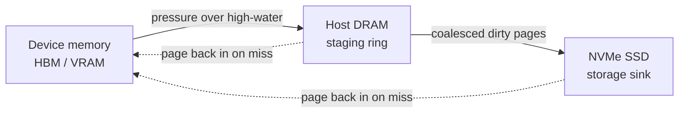
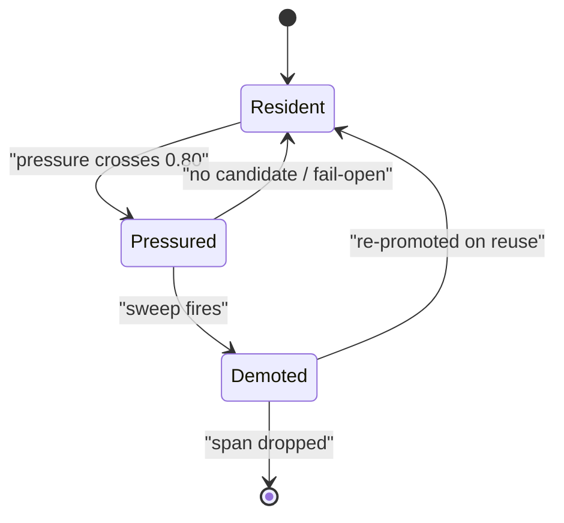
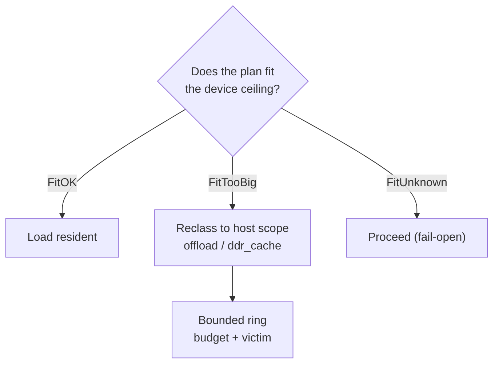

# Host DRAM, offload, and the frontier

*You are on **Level 5 of 5** of the [fak memory-hierarchy ladder](README.md).*

> **Audience.** A researcher or systems lead who has finished Levels 1–4 and now
> wants the tiers *below* the accelerator. By the end you will be able to say why a
> model that does not fit is a residency problem rather than a capacity wall, why a
> memoizer is not a cache, what the activated-expert gap buys you, how host DRAM
> stages writes before they reach the SSD, how a served turn relieves KV pressure,
> and — the part that matters most — exactly which of these edges are shipped and
> which are still planks.

> **Short answer.** The device does not have to hold the whole model; it has to hold
> what is *live*. Everything else can sit in host DRAM or on NVMe and be paged in on
> demand, which turns "the model does not fit" from a dead end into a residency
> policy. fak lifts that policy into the type system (`MemoryClass`, `MemoryScope`,
> `MemoryPlan`), bounds it with a real byte budget and a real victim, and coalesces
> the writes that fall out the bottom so the SSD's *endurance*, not its speed, is the
> constraint. Several of these edges are shipped and witnessed; several are tracked
> planks, and this rung names which is which.

## What happens when the model does not fit on the device at all?

It is not a dead end, because the device never had to hold everything. It has to
hold what is *live* — the weights a token actually touches, the KV span a turn
actually reads, the scratch a kernel actually needs. The rest can live one tier
down and be fetched when its turn comes. The failure mode people fear ("the model
is bigger than the card, so it cannot run") is really a *residency* question: which
bytes must be resident *now*, and where do the others wait?

The mechanism is a typed vocabulary for that question. A demand is classed —
weights, KV cache, DDR cache, offload staging, scratchpad, activation, signal
buffer — and scoped to a pool, device or host (`internal/compute/capacity.go:61`,
`internal/compute/capacity.go:68`, `internal/compute/capacity.go:69`,
`internal/compute/capacity.go:77`, `internal/compute/capacity.go:81`). A
`MemoryDemand` carries one classed, scoped byte count
(`internal/compute/capacity.go:87`), and a `MemoryPlan` is a list of them
(`internal/compute/capacity.go:100`) — pure data a loader can build from headers
*before* allocating. The fit check returns a typed verdict, and the crucial one is
`FitUnknown` (`internal/compute/capacity.go:733`): a backend that cannot probe its
own ceiling reports "unknown" and the caller **proceeds**, never refuses. This is
the eighth assumption the HAL lifts — the first seven describe what a device
*looks* like, this one describes the one thing every accelerator runs out of
(`internal/compute/compute.go:311`).

**Worked example (illustrative).** Suppose a device ceiling of 24 GB and a plan of
weights 20 GB (device) + KV cache 8 GB (device) + offload 60 GB (host). The device
total is 20 + 8 = 28 GB, which exceeds 24 GB, so the plan refuses on the device
side. The host total is 60 GB against, say, a 128 GB host ceiling, which fits. The
remedy is not "give up" — it is to reclass the weights as host-scoped `offload` and
let the residency policy page them in. The refusal is a *sizing message before the
allocation that would otherwise panic*, not a verdict on feasibility.

## Why is a memoizer not a cache?

Because a cache has three things a memoizer lacks: a **budget**, a **victim**, and
**accounting**. A memoizer just remembers every key it has ever seen and never
forgets. That is fine for a pure function with a small key space; it is a slow
disaster for a model, because residency then grows *monotonically* — the union of
everything ever touched — until it converges on the whole model.

The mechanism is visible in the serve path's two original placements, both
unbounded. The host path runs every expert on the host kernel for the life of the
session — the floor, not a cache. The device path memoizes every uploaded weight
handle in a map that is torn down only at `Close`, so device residency is the union
of every expert activated since the session started, monotonically converging on
the full expert bulk. The file that names this is explicit: *"A memoizer, not a
cache: no budget, no victim, no accounting"* (`internal/model/expert_ring_hal.go:31`).

**Worked example (illustrative).** Take 256 experts at 0.5 GB each — 128 GB stored.
If a session activates 8 *new* experts per token for 1000 tokens with no repeats,
that is 8000 activations, but only 256 distinct experts exist, so residency climbs
to 128 GB and stays. A bounded ring of 16 GB holds 16 / 0.5 = 32 experts, about 12.5%
of the bulk — and, unlike the memoizer, it *stays* at 16 GB because it has a victim
to evict.

## What is the activated-expert insight?

The gap between **stored** bytes and **activated** bytes. A frontier
mixture-of-experts checkpoint stores every expert but routes each token through only
a small fraction of them, so most of the stored bulk is cold on any given token. That
gap is the whole opportunity, and it is a residency problem, not a capacity one.

The mechanism bounds the *routed* expert bulk under a declared byte budget. When a
session declares a budget, staging a routed expert weight (`.mlp.experts.N.*`, kept
distinct from the shared expert every token uses, `.mlp.shared_experts.*`) goes
through a paged ring instead of the unbounded memo map: the handle is admitted under
the budget, the coldest unpinned expert is evicted to make room, and an evicted
expert pages back in on its next activation. Dense projections, attention, the
router, the output head, and the shared expert keep permanent residency, because
those are activated every token and evicting them could only cost. The default is
**off, byte-for-byte** — a session that declares no budget takes the unchanged path
(`internal/model/expert_ring_hal.go:56`). The residency is then made *readable*: a
single report folds the ring's ledger, the checkpoint tier's IO, and the derived
rates an operator tunes against, with a reconciliation identity
(`Hits + PageIns + Refusals == Lookups`) whose two sides come from different
increments so the check can actually fail (`internal/model/expert_residency_report.go:28`).

**Worked example (illustrative).** A checkpoint routes top-8 of 256 experts, so the
activated fraction is 8 / 256 = 0.03125, about 3.1%. If the stored expert bulk is
200 GB, the activated bytes per token are roughly 200 × 0.03125 = 6.25 GB. The
budget accounts the *quantized* resident footprint, not an f32 expansion: at roughly
0.56 bytes per weight for a 4-bit k-quant versus 4 bytes for f32, a ring sized for N
f32 experts holds about 4 / 0.56 ≈ 7× as many quantized ones.

## How does host DRAM stage writes before they reach the SSD?

It absorbs the writes in a ring and coalesces them, so the SSD sees one write where
the workload produced many. The constraint this protects is **endurance**, not
speed: a flash cell tolerates a finite number of program/erase cycles, and a
high-frequency local cache that rewrites the same page every turn would burn through
that budget long before it ran out of bandwidth. The parent issue frames the whole
design as an SSD-endurance and multi-year-lifespan budget for high-volume local
caching (`internal/compute/dram_ring.go:11`).

The mechanism is a write-back staging ring with lazy flush. It holds dirty pages in
host memory under a byte capacity — 2 GiB by default
(`internal/compute/dram_ring.go:16`) — and a page is eligible for flush only after a
dwell cooldown of 60 seconds (`internal/compute/dram_ring.go:19`), inside a
recommended 60-to-120-second window (`internal/compute/dram_ring.go:22`,
`internal/compute/dram_ring.go:25`). Repeated writes to the same page inside that
window update the resident copy and reset its dwell timer; only when the page has
been quiet for the cooldown does the ring hand it to the storage sink. A page that
is rewritten before it flushes is never written to the SSD at all.



**Worked example (checkable).** The default capacity is 2 × 1024 × 1024 × 1024 =
2,147,483,648 bytes. At a 4 KiB page that is 2,147,483,648 / 4096 = 524,288 pages
resident. If one page is rewritten 100 times inside a single 60-second window, the
ring flushes it once, so the SSD sees 1 write instead of 100 — a 100× reduction in
program/erase cycles for that page, which is exactly the endurance budget the design
is protecting.

## How does the KV cache relieve pressure after a decode turn?

By *demoting* a hot span to a colder tier instead of dropping it. When a served turn
has mutated the KV cache and live device pressure crosses a high-water mark, the
gateway runs a sweep that moves a span down a tier rather than evicting it — the
bytes survive, they just get colder.

The mechanism is a post-decode consumer on the serve path
(`internal/gateway/kvmmu_pressure_relief.go:134`). It is **default-on**: the demote
edge runs unless the operator sets `FAK_KV_PRESSURE_RELIEF` to a disabling value
(`internal/gateway/kvmmu_pressure_relief.go:177`). It is also **fail-open** at every
fence: a disabled policy, a missing provider or sweeper, or an empty candidate list
all return a no-op that is byte-identical to the pre-existing served path. The
high-water mark defaults to 0.80 of the device ceiling, so demotion begins *before*
the allocator is literally out of memory.



**Worked example (checkable).** If live KV residency is 40 GB against a 48 GB device
ceiling, pressure is 40 / 48 = 0.833, which is above the 0.80 high-water mark, so the
sweep fires and demotes a span. At 38 GB the pressure is 38 / 48 = 0.792, below the
mark, so nothing moves. The threshold is a fraction of the ceiling, not a fixed byte
count, so it scales with the device.

## What happens when the hierarchy partly collapses?

On an integrated-memory APU the tiers stop being separate pools. There is one
physical memory that is both device-local and host-visible, so the "copy from host
to device" step that dominates the discrete-GPU story can disappear entirely — the
hierarchy does not vanish, but its most expensive edge is short-circuited.

The mechanism is a weight arena mapped with both device-local and host-visible
properties, so the dense base is written through the mapped arena with no staging
copy (`internal/compute/vulkan_uma_direct_test.go:14`). The property flags that make
this possible are the same ones a discrete device keeps apart — device-local,
host-visible, host-coherent (`internal/compute/vulkan_memory_guard_test.go:117`).
Where a copy *is* still needed, the allocator aligns to the hardware's real
granularity: 64 bytes for a cache line, 4096 for a page
(`internal/compute/direct_slab.go:20`). And the HAL already anticipates the collapse
at the type level: a weight source may hand back a pre-staged device-native buffer
rather than a single host-resident blob, lifting the eager-full-RAM-residency
assumption (`internal/compute/compute.go:394`).



**Worked example (illustrative).** A 512 MiB carve-out on an integrated-memory APU
leaves the weights in the host-visible fallback; with direct upload on, that buffer
is mapped too and the upload skips the staging copy. On a discrete device the same
weights would cross the bus twice — once into a staging buffer, once into
device-local memory — which is the edge the unified case removes.

## What is still open

These are tracked planks, not solved problems. Read them as the honest edge of the
rung.

- **The pressure-relief edge is wired, but only for a native in-kernel planner with
  a host-L2 byte budget.** The post-decode sweep is default-on, and the production
  candidate provider is no longer nil: `fak serve` installs a real one whenever the
  server's planner is a direct `*agent.InKernelPlanner`
  (`internal/gateway/inkernel_prefix_pressure.go:8`), and that planner enumerates
  live device-resident prefix payloads from the radix tree
  (`internal/radixkv/host_l2.go:39`). The enumerator is gated, though: it returns
  nothing unless the tree has a host-L2 or remote-snapshot budget
  (`internal/radixkv/host_l2.go:40`), and the installer passes a nil provider for
  every other serve shape — proxy, dual, upstream, or CPU-only
  (`cmd/fak/serve_stages.go:1110`). So the honest statement is *conditional*, not
  *absent*: on a native device serve with a host-L2 budget the demote-not-drop edge
  runs against real spans, and everywhere else it is the fail-open no-op
  (`internal/gateway/kvmmu_pressure_relief.go:134`).
- **Not every model loader has a complete memory plan yet.** The classed
  `MemoryPlan` fit check ships for the GGUF serve device-load paths; other loaders
  and upload pre-checks are not yet covered, so a loader can still reach an
  allocation without a plan.
- **The expert ring is default-off and its rungs are staged.** The bounded ring is
  R0 of a ladder; the operator knob that *sizes* the budget, the warm-start pin-set,
  the async prefetch on the miss path, the policy seam that replaces LRU on measured
  regret, and the checkpoint tier under a miss are separate, later rungs
  (`internal/model/expert_ring_hal.go:59`).
- **The capacity escape when one device is not enough is shipped, but only under an
  opt-in build.** A real cross-device collective does exist: the CUDA backend
  implements `CollectiveBackend` over a genuine NCCL communicator, one `ncclComm_t`
  per visible device, and advertises `Caps().Collective` only after that
  communicator initializes over more than one device
  (`internal/compute/cuda_collective.go:15`). `fak serve` then refuses
  `--expert-parallel/--tensor-parallel N>1` unless some backend advertises it
  (`cmd/fak/serve_stages.go:584`). The condition is the *build*: the file compiles
  only under `-tags cuda,nccl` with `FAK_CUDA_NCCL=1`
  (`internal/compute/cuda_collective.go:1`), and the default pure-Go binary and the
  plain `-tags cuda` build never link it. So the honest statement is *conditional*,
  not *absent*: on a multi-GPU box with the NCCL rung built, the tensor-parallel
  reduction is a device collective; everywhere else the serve path exits 2 rather
  than silently falling back to a host-staged sum.
- **The staging ring's sink is the operator's.** The ring coalesces and hands pages
  to a storage callback; it does not itself own the SSD's wear-leveling or the
  lifespan accounting the parent issue describes (`internal/compute/dram_ring.go:11`).

## Try it

From the repository root, read the staging ring's constants and the coalescing
window directly:

```sh
sed -n '9,30p' internal/compute/dram_ring.go
```

You will see the 2 GiB default capacity and the 60-to-120-second cooldown window
that the worked example above is built from. To see the capacity vocabulary the
first section leans on, read the class and scope declarations:

```sh
sed -n '61,100p' internal/compute/capacity.go
```

## See also

- [The caching ladder](../caching/README.md) — the sibling five-rung ladder: caching
  is *what* to keep close, this ladder is *where* close is.
- [Hardware limits and capacity](../hardware-limits-and-capacity.md) — the "eighth
  assumption" and the plank-by-plank bridge this rung's open edges come from.
- [Addressable KV cache](../addressable-kv-cache.md) — the KV span the pressure
  sweep demotes, and what "addressable" means for it.
- [Memory engineering](../memory-engineering.md) — the broader discipline of
  arranging residency across tiers.
- [The memory-bandwidth field guide](../../benchmarks/MEMORY-BANDWIDTH-FIELD-GUIDE.md)
  — how to tell a measured ceiling from a marketing one, which is the discipline
  behind every number on this rung.
- [When the model does not fit: residency, not a capacity wall](../../../visuals/89-offload-tier-ladder.mmd)
  — this rung's tier ladder, rendered standalone (`.svg` / `.png` beside it).

---

*[← Level 4 — HBM, VRAM, and the roofline](level-4-hbm-vram-and-the-roofline.md) · [full ladder](README.md)*
